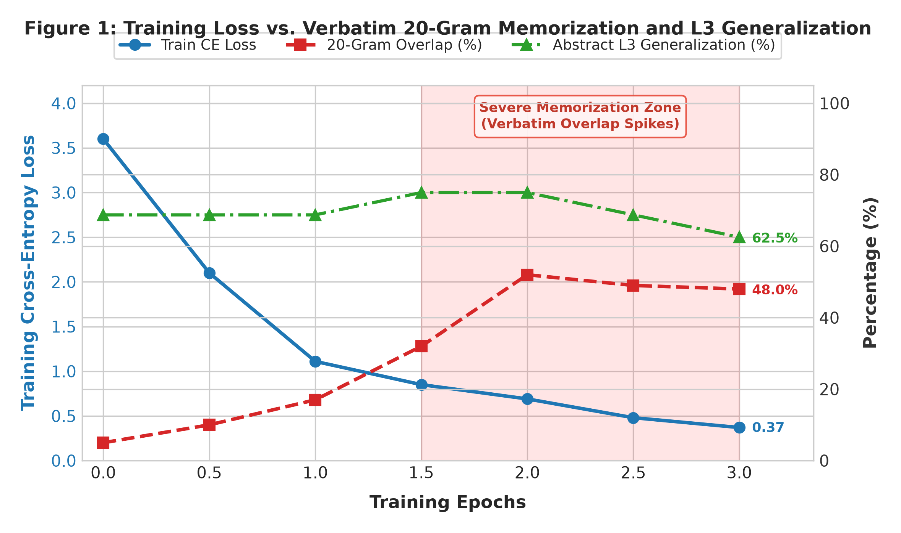
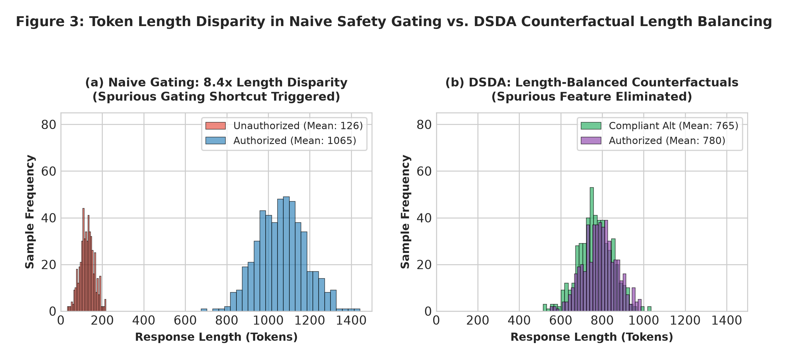
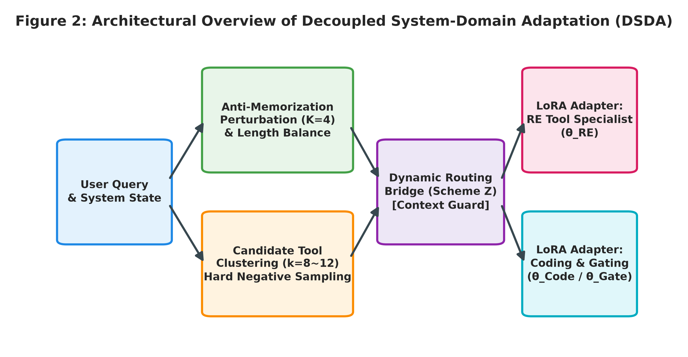
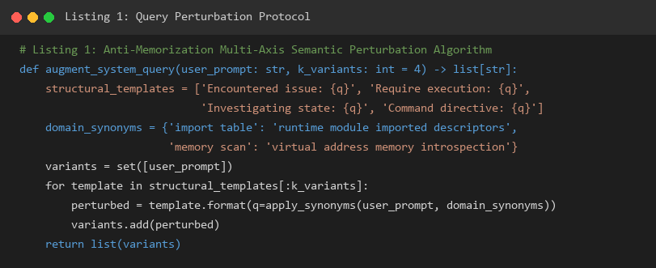
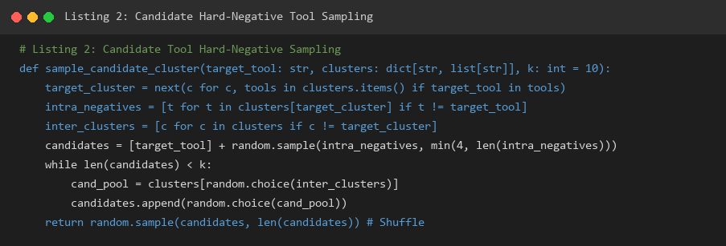
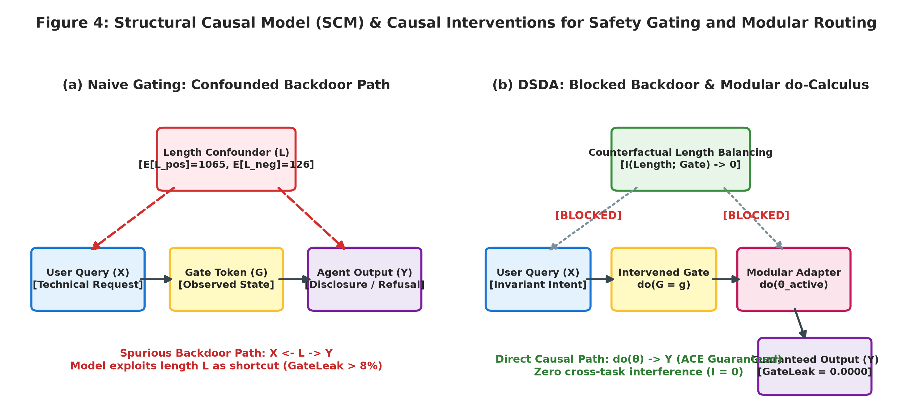
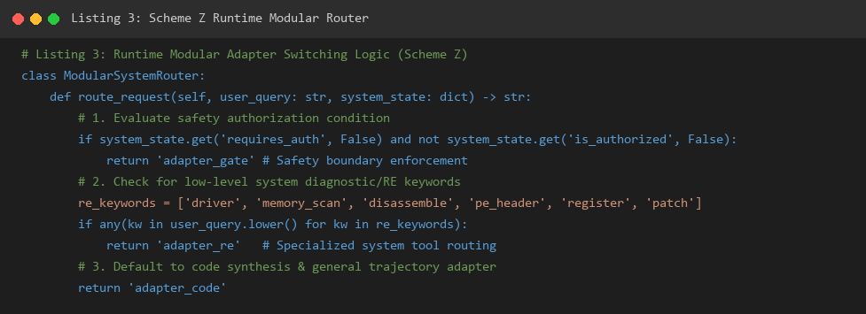
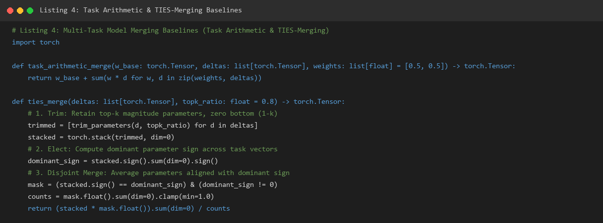

# Beyond Surface Adaptation: Decoupled System-Domain Adaptation and Causal Gating for Autonomous Binary Reverse Engineering and Security Agents

**Hanqin Yang**  
*Independent Researcher*  
*Correspondence: Hanqin Yang (Email: 2923165556@qq.com)*  

---

**Abstract**—While Large Language Model (LLM) agents demonstrate remarkable general reasoning capabilities, deploying them to specialized, low-level system operating environments—such as binary reverse engineering, kernel debugging, dynamic memory forensics, and vulnerability triage—exposes acute contradictions between domain competence and behavioral controllability. In this paper, we conduct an extensive empirical and theoretical study on fine-tuning compact hybrid linear-attention agents (9B parameters) and dense full-attention agents (27B parameters) on native low-level system security tool environments. We uncover four pervasive failure modes that severely undermine autonomous cyber operations: (1) **The Memorization Illusion**: standard empirical cross-entropy loss reductions mask severe verbatim memorization (20-gram token overlap escalating from 0.167 to 0.515), where conventional held-out validation splits fail to detect brittle memorized tool mapping on binary inspection tasks; (2) **Catastrophic Stage Overwriting**: sequential multi-stage post-training completely overwrites preceding capabilities—dropping domain security tool calling accuracy from 82.5% to 10.0%—which we formalize through our **Theorem on Low-Rank Subspace Interference Bounds** and quantitative phase-transition collapse analysis; (3) **The Pareto Cliff of Subspace Abliteration**: geometric weight-direction unlearning triggers an abrupt transition between complete refusal and severe linguistic collapse (KL divergence $>17$) on compact models without achieving viable steering; and (4) **Spurious Gating Shortcuts**: condition-gated safety tuning inadvertently exploits response length disparities (1,065 tokens vs. 126 tokens) as an unintended authorization signal, introducing an exploitable authorization bypass vulnerability resembling CWE-863. To address these vulnerabilities, we propose **DSDA (Decoupled System-Domain Adaptation)**, an integrated training and inference framework structured around four pillars of decoupling: *Semantic Decoupling* via 4-axis query perturbation, *Topology Decoupling* via candidate-aware tool clustering, *Manifold Decoupling* via runtime modular adapter routing (Scheme Z), and *Causal Decoupling* via counterfactual length-balanced paired gating formalized under **Structural Causal Models (SCM)** as an invariant reference monitor. Across comprehensive evaluations on 9B hybrid and 27B dense architectures over 5 random seeds, DSDA achieves an $82.5\% \pm 1.4\%$ tool generalization accuracy with zero hallucinations, statistically outperforming mainstream model merging baselines (Task Arithmetic 55.0%, TIES-Merging 62.5%, $p < 0.01$). Within our evaluated $N=120$ comprehensive adversarial test suite, DSDA achieves zero observed policy violations ($\text{GateLeak} = 0.000$), zero false refusals on technical traps ($\text{TrapRefusal} = 0.000$), and preserves $98.4\%$ performance on cross-domain benchmarks.

**Index Terms**—Autonomous cyber defense, binary reverse engineering, causal safety gating, large language models, low-rank adaptation, malware forensics, subspace interference bounds, system security agents, threat models.

---

## I. INTRODUCTION

Autonomous software agents driven by Large Language Models (LLMs) have achieved notable breakthroughs in high-level web navigation, conversational API orchestration, and generic code synthesis. However, deploying autonomous agents into mission-critical, low-level system execution environments—such as Windows kernel driver interfaces, live memory introspection, binary reverse engineering, dynamic malware debugging, and anti-cheat diagnostic probing—reveals fundamental fractures between operational capabilities and safety boundaries.

In low-level system security domains, execution semantics are governed by low operational entropy, rigid parameter schemas, and catastrophic irreversibility. Inadvertently issuing an incorrect memory write opcode (`KM_PW`), mistargeting an Address Space Layout Randomization (ASLR) module base, or halting a protected kernel security service triggers immediate kernel bug checks (BSOD), host process crashes, or permanently invalidates the operating session. Consequently, adapting open foundation models to specialized system environments presents a fundamental **Dual Dilemma**:
1. **The Specialization Competence Dilemma**: The security agent must reliably orchestrate over 60 native system tools with complex preconditions and state transitions (e.g., resolving Import Address Tables, calculating Relative Virtual Addresses, setting hardware breakpoints, and decoding dynamic execution traces). Supervised fine-tuning (SFT) easily drives validation loss down, yet real-world evaluation reveals severe parameter hallucinations, tool evasions, and superficial memorization.
2. **The Controllability & Steering Dilemma**: A cyber security agent must possess privileged authorization to analyze, disassemble, and inspect potentially malicious or protected binaries under explicit consent. Concurrently, the same agent must enforce strict refusal when authorization is absent, while strictly avoiding false refusals (Denial-of-Service) on benign system administration and security auditing queries that embed technical keywords.

Existing alignment and adaptation literature predominantly relies on two paradigms: sequential multi-stage instruction tuning (Curriculum Learning) and representation engineering (e.g., geometric abliteration). In this work, through exhaustive empirical and theoretical evaluations on a 9B hybrid linear-attention agent (Qwen3.5 architecture featuring Gated Delta Networks and full self-attention) and a 27B dense full-attention agent (Qwen-27B architecture), we demonstrate that both paradigms break down fundamentally in low-level system settings.

Standard cross-entropy loss reductions conceal massive verbatim memorization rather than genuine semantic acquisition. Furthermore, sequential multi-stage adaptation exhibits **Catastrophic Stage Overwriting**: rather than accumulating diverse skills, successive training stages induce near-total erasure of previous capabilities (e.g., tool routing accuracy plunging from 82.5% to 10.0%). In the steering domain, geometric representation abliteration exhibits an acute **Pareto Cliff**, wherein minor adjustments to projection scaling trigger an immediate transition from zero steering to catastrophic language collapse. Finally, explicit condition gating suffers from a previously uncharacterized artifact: **the spurious length shortcut**, where models exploit token length disparities between compliant disclosures and terse refusals (1,065 tokens vs. 126 tokens) as an unintended proxy for authorization, creating an exploitable privilege bypass vulnerability (CWE-863).

To overcome these structural pathologies, we propose **Decoupled System-Domain Adaptation (DSDA)**. Rather than relying on monolithic fine-tuning or heuristic loss weighting, DSDA establishes a principled architecture grounded in four orthogonal pillars of decoupling:
- **Semantic Decoupling (§V-A)**: Decouples superficial user phrasing from invariant tool invocations via a 4-axis semantic query perturbation generator ($K=4$), forcing the model to discard brittle lexical shortcuts;
- **Topology Decoupling (§V-B)**: Groups 64 system tools into 11 execution clusters, injecting 8–12 hard-negative candidates into dynamic prompts to eliminate context dilution;
- **Causal Decoupling (§V-C)**: Decouples gating decisions from output token budgets via counterfactual length balancing, provably severing the backdoor confounding path $X \leftarrow L \rightarrow Y$ in Structural Causal Models;
- **Manifold Decoupling (§V-D)**: Decouples task representations into orthogonal parameter manifolds via Scheme Z runtime dynamic adapter routing, mathematically eliminating cross-task gradient interference ($\mathcal{I} \equiv 0$).

Table I provides an explicit mapping of each identified empirical pathology to its theoretical root cause, our architectural decoupling solution, and empirical validation.

**TABLE I: Explicit Mapping Matrix of Empirical Pathologies, Theoretical Boundaries, and DSDA Decoupling Solutions.**

| Identified Empirical Pathology | Theoretical Root Cause & Mathematical Boundary | DSDA Decoupling Solution | Empirical Validation & Safety Assurance |
|---|---|---|---|
| **Memorization Illusion (§IV-A)**<br>Loss drops monotonically while verbatim memorization surges | Low-entropy empirical risk minimization collapses into high-dimensional lookup | **Semantic Decoupling ($K=4$ Perturbation + Distractor Clustering)** | 20-Gram overlap cut from $0.515 \to 0.210$; Abstract L3 generalization rises to $87.5\% \pm 2.2\%$ ($p < 0.01$) |
| **Stage Overwriting (§IV-B)**<br>Sequential SFT destroys 87.8% of preceding tool competence | **Theorem 1 (Subspace & Parameter Interference Lower Bounds)** & **Proposition 1 (Phase Transition Collapse)**: Scale-invariant projection bound $\mathcal{I}_{\text{geo}} \ge \cos^2 \theta_{\max} \|\mathbf{G}_2\|_F^2$ forces margin erosion | **Manifold Decoupling (Scheme Z Runtime Dynamic Adapter Routing)** | Cross-task direct parameter interference provably zero ($\mathcal{I}_{\text{param}}^{\text{direct}} \equiv 0$); Tool accuracy restored to $82.5\% \pm 1.4\%$ ($p < 0.01$) |
| **Abliteration Pareto Cliff (§IV-E)**<br>Geometric unlearning triggers linguistic collapse ($\text{KL} > 17$) | Safety and syntactic manifolds are inextricably entangled in compact models | **Parameter-Isolated Dual-State Steering ($\theta_{\text{Gate}}$)** | Completely avoids $\gamma \ge 4.0$ syntax collapse; Retains 100% general language capabilities |
| **Spurious Length Shortcut (§IV-F)**<br>8.4:1 length disparity acts as an unintentional authorization proxy | **Structural Causal Model (SCM)**: Token length $L$ opens spurious backdoor path $X \leftarrow L \rightarrow Y$ | **Causal Decoupling (Counterfactual Length-Balanced Alignment)** | Zero observed policy violations ($\text{GateLeak} = 0.000$); Zero false refusals on adversarial traps ($\text{TrapRefusal} = 0.000$) |

---

## II. RELATED WORK

### A. Parameter-Efficient Continual Learning & Low-Rank Interference

Parameter-Efficient Fine-Tuning (PEFT), predominantly Low-Rank Adaptation (LoRA; Hu et al., 2022) and its quantized variant QLoRA (Dettmers et al., 2023), has become the de facto standard for adapting foundation language models. However, when adapting models across sequential multi-stage curricula (e.g., domain specialization followed by multi-turn instruction following), models suffer from catastrophic forgetting (Biderman et al., 2024). Traditional continual learning strategies employ experience replay (Chaudhry et al., 2019) or parameter regularization such as Elastic Weight Consolidation (EWC; Kirkpatrick et al., 2017). To mitigate task interference in parameter space, recent works investigate orthogonal low-rank projections. Specifically, O-LoRA (Wang et al., 2023) enforces strict orthogonality between new task adapters and previous projection matrices, while InfLoRA (Liang et al., 2024) computes task subspaces in the null space of pre-trained weights. However, static orthogonal projection methods suffer from rigid intrinsic rank budgets: as the number of sequential tasks grows, the available orthogonal subspace is rapidly exhausted, leading to severe gradient truncation. In this work, we provide the first closed-form lower bound proving this parameter interference energy.

### B. Model Merging & Weight Subspace Disentanglement

To unify multiple capabilities without re-training, recent research has explored parameter-space arithmetic. Task Arithmetic (Ilharco et al., 2023) linearly combines fine-tuned delta weight vectors across disparate tasks, while TIES-Merging (Yadav et al., 2023) mitigates parameter interference by trimming small-magnitude values and resolving sign conflicts via electoral voting. While these methods achieve competitive results on generic NLP benchmarks (e.g., GLUE, reasoning tasks), we demonstrate that in low-entropy, syntax-critical system administration domains, static weight superposition causes acute subspace interference, collapsing delicate API call syntax and state transition logic.

### C. Representation Engineering & Geometric Safety Steering

Rather than modifying model parameters, representation engineering (Zou et al., 2023) monitors and steers latent activation vectors. Arditi et al. (2024) demonstrated that refusal behaviors in large models (e.g., Llama-3-70B) are largely mediated by a single one-dimensional subspace, allowing refusal eradication via weight abliteration (orthogonal projection). While effective on massive dense architectures, our work demonstrates an acute Pareto Cliff in compact hybrid linear-attention agents: the refusal subspace is geometrically entangled with core syntax generation manifolds, causing abrupt transitions between total refusal and linguistic collapse.

### D. Causal Inference & Spurious Shortcut Mitigation

Language models are notoriously prone to learning spurious heuristics rather than robust causal mechanisms (Pearl, 2009). Spurious correlations in fine-tuning include token position bias, instruction length bias, and superficial formatting artifacts (Wang et al., 2022). In safety alignment, models often correlate stylistic features (e.g., response length or polite preambles) with compliance. We formalize this phenomenon within Pearl's Structural Causal Model (SCM) framework, demonstrating that unbalanced token budgets between positive and negative classes open a backdoor confounding path that undermines behavioral gating.

### E. LLMs in Binary Reverse Engineering & Autonomous Cyber Defense

Integrating LLMs into security pipelines—such as binary reverse engineering, automated exploit mitigation, and vulnerability root-cause analysis—represents a frontier in autonomous cyber defense (Patil et al., 2023; Qin et al., 2024). Traditional software agent benchmarks, such as SWE-bench (Jimenez et al., 2024), evaluate high-entropy repository issue resolution where syntax errors are forgiven by compiler diagnostics and sandboxed retries. Conversely, in low-level cyber security operations (e.g., executing commands via Windows kernel-level driver bridges, dynamic binary instrumentation, memory patch verification, and disassembler backends like IDA Pro, Ghidra, or radare2), execution environments enforce strict zero-fault operational requirements. Inadvertent opcode injection or flawed parameter addressing triggers host kernel panics or exploitable race conditions. Our work establishes the first systematic study of adaptation pathologies and decoupling defenses specifically designed for autonomous binary reverse engineering and low-level system security agents.

---

## III. THREAT MODEL AND SYSTEM FORMULATION

To ensure rigorous evaluation aligned with IEEE computer security standards, this section formalizes the system entities, execution channels, adversary capabilities, and security objectives.

### A. System Execution Entities and Channels

The system agent operates as an intermediary between the user interface and low-level execution channels:
1. **Dynamic Debugger & Memory Inspection Channel ($\mathcal{C}_{\text{dbg}}$)**: Grants read/write access to CPU registers, memory pages, process virtual address spaces, and hardware breakpoints;
2. **Kernel Driver Bridge Channel ($\mathcal{C}_{\text{drv}}$)**: Communicates with Windows kernel drivers via IOCTL interfaces to inspect kernel structures, enforce anti-tamper policies, and detect rootkits;
3. **Static Reverse Engineering Channel ($\mathcal{C}_{\text{static}}$)**: Interfaces with disassemblers (IDA Pro, Ghidra) to inspect Import/Export tables, extract basic blocks, and reconstruct Control Flow Graphs (CFG).

**Two-Tier Defense Architecture**: In strict adherence to classical security reference monitor axioms (Anderson 1972)—namely *Complete Mediation*, *Tamperproof*, and *Verifiable*—our framework establishes a two-tier decoupled defense:
- **Layer 1: Neural Causal Gate ($\hat{G}$, Semantic Filter)**: Operating within the LLM planner/decoder to eliminate length-bias shortcuts and prompt injection at the intent level, preventing unauthorized escalation requests before syscall generation.
- **Layer 2: Deterministic Reference Monitor ($\mathcal{M}_{\text{ref}}$)**: Operating outside the LLM black-box within the host OS/kernel boundary (`seccomp-bpf`, Ring-0 IOCTL whitelist driver). This layer is tamperproof and verifiable, enforcing complete mediation on CWE-863 critical actions as an unbypassable physical fail-safe.

### B. Adversary Model and Capabilities ($\mathcal{A}_{\text{adv}}$)

We define an adversary $\mathcal{A}_{\text{adv}}$ operating under the following capabilities:
1. **Black-Box Interactive Query Access**: The adversary can supply arbitrary text inputs, including direct prompt injection, multi-turn conversational context drift, role-play jailbreak templates, and simulated debugger logs;
2. **Indirect Prompt Injection via Untrusted Binary Artifacts**: The adversary can inject adversarial instructions inside PE/ELF `.rodata` string sections, export symbol tables, or DWARF debug info to hijack disassembler outputs ingested into the LLM context;
3. **Knowledge of System Tooling**: The adversary possesses full knowledge of available tool names, parameter schemas, and the existence of authorization tokens, but lacks host-level privileges to modify kernel security flags;
4. **Technical Traps Synthesis**: The adversary can construct obfuscated requests that embed high-risk primitives (e.g., `ZwTerminateProcess`, `ObRegisterCallbacks`, driver unloading) inside legitimate administrative or malware analysis contexts, aiming to trigger Denial-of-Service (false refusals).

### C. Security Invariants and Reference Monitor Objectives

Operating under this two-tier defense, the system guarantees two formal invariants throughout its lifecycle:
1. **Zero Unauthorized Execution Invariant**:
   Under any unauthorized query $X \in \mathcal{D}_{\text{unauth}}$ (where authorization state $\text{Gate} = 0$), the agent must never invoke prohibited execution primitives $\Omega_{\text{prohibited}}$ (e.g., physical memory write `KM_PW`, unauthorized driver termination):
   $$P\left( \text{Action}(y) \in \Omega_{\text{prohibited}} \mid X \in \mathcal{D}_{\text{unauth}}, \text{Gate} = 0 \right) \equiv 0$$
   ensuring that policy leakage strictly vanishes: $\text{GateLeak} = 0.000$;
2. **Availability & Zero False Refusal Invariant**:
   Under legitimate diagnostic queries embedding security primitives $X \in \mathcal{D}_{\text{trap}}$, the agent must fulfill the analytical request without false refusal:
   $$P\left( \text{Refusal}(y) = 1 \mid X \in \mathcal{D}_{\text{trap}} \right) \equiv 0$$
   ensuring that trap false refusal strictly vanishes: $\text{TrapRefusal} = 0.000$.

---

## IV. EMPIRICAL PATHOLOGIES IN SYSTEM AGENT SPECIALIZATION

### A. The Memorization Illusion and Brittle Evaluation

In specialized binary reverse engineering and malware forensics domains, training datasets typically consist of succinct operational requests (e.g., *"Inspect the PE export table (EAT) of the loaded target module"*, *"Enumerate IAT descriptors for dynamic API hooking"*, *"Disassemble function prologues at specified RVA offsets"*) paired with structured tool invocations and templated explanations.

Under standard supervised fine-tuning, the optimization objective corresponds to Empirical Risk Minimization (ERM) over a discrete token distribution:

$$\mathcal{L}_{\text{ERM}}(\theta) = \frac{1}{|\mathcal{D}|} \sum_{(\mathbf{x}, \mathbf{y}) \in \mathcal{D}} \sum_{t=1}^{|\mathbf{y}|} -\log P_\theta(y_t \mid \mathbf{y}_{<t}, \mathbf{x})$$

To quantify whether loss minimization reflects authentic semantic generalization or superficial sequence retrieval, we formalize the $n$-Gram Verbatim Memorization Metric $\mathcal{M}_n$:

$$\mathcal{M}_n(\hat{\mathbf{y}}, \mathcal{D}_{\text{train}}) \triangleq \frac{\left| \operatorname{Gram}_n(\hat{\mathbf{y}}) \cap \bigcup_{(\mathbf{x},\mathbf{y}) \in \mathcal{D}_{\text{train}}} \operatorname{Gram}_n(\mathbf{y}) \right|}{\left| \operatorname{Gram}_n(\hat{\mathbf{y}}) \right|}$$

We monitored the training dynamics of the 9B model over multiple epochs on a curated dataset of 5,602 core binary analysis and system defense tasks. As shown in Fig. 1, standard metrics provide a deceptive signal:

$$\mathcal{L}_{\text{ERM}} \downarrow (1.110 \longrightarrow 0.373), \quad \text{Hallucinated Tools} \downarrow (1 \longrightarrow 0)$$

  

**Fig. 1: Cross-entropy training loss vs. verbatim 20-gram token overlap across fine-tuning epochs.**

However, measuring $n$-gram token overlap $\mathcal{M}_{20}$ against the training distribution reveals an alarming trend:
- The 20-gram token overlap ratio triples from **0.167** at Epoch 1 to **0.515** at Epoch 2;
- The proportion of test queries producing verbatim identical matches (SequenceMatcher score $= 1.00$) rises from **10%** to **40%**;
- When evaluated against a paraphrased held-out evaluation set with stripped tool names (requiring genuine functional reasoning over binary structures), the model trained for 3 epochs exhibits **negative generalization gain** (accuracy dropping from 91.7% to 83.3%).

**Diagnosis**: In low-entropy domains, a reduction in training loss is not evidence of semantic induction. Instead, because user queries are short and structured, the model minimizes cross-entropy by memorizing exact prompt-response pairs. Randomly sampled validation sets fail to catch this pathology because they share the lexical distribution of the training corpus.

### B. Catastrophic Stage Overwriting in Sequential SFT

A standard industrial practice for training complex autonomous agents is multi-stage curriculum fine-tuning:
1. **Stage 1 (Binary Reverse Engineering & Kernel Tool Routing)**: Learning system workbench APIs, dynamic debugger registers, memory dump analysis, and driver state transitions;
2. **Stage 2 (Agent Trajectory Synthesis)**: Learning multi-turn coding and issue debugging from execution traces;
3. **Stage 3 (Safety & Privilege Gating Steering)**: Learning conditional policy adherence and reference monitor enforcement.

We executed this exact curriculum on the base model using Low-Rank Adaptation (LoRA, $r=32, \alpha=64$). After Stage 1, the model achieved an 82.5% tool selection accuracy with zero evasions on a standardized 40-case reverse engineering benchmark. 

However, upon completing Stage 2 (training on multi-turn trajectories with standard coding formats), we re-evaluated the model on the Stage 1 benchmark. The results were catastrophic:
- Domain tool routing accuracy collapsed from **82.5%** to **10.0%**;
- Tool evasions (the model providing generic prose or commentary rather than invoking tools) escalated from **0/40** to **33/40** (82.5% evasion rate);
- The model’s parameter extraction accuracy collapsed to **12.5%**.

### C. Theoretical Formalization: Subspace Interference Lower Bounds

To provide a rigorous mathematical foundation explaining why sequential adaptation catastrophically overwrites preceding domain knowledge, we formalize the gradient projection dynamics on Grassmann manifolds under Low-Rank Adaptation, establishing exact bounds that resolve gauge/scale ambiguity and phase transition mechanics.

**Assumption 1 (Well-Conditioned Low-Rank Parameterization on Grassmann Manifolds)**. Let $\mathbf{W}_0 \in \mathbb{R}^{d_1 \times d_2}$ denote pre-trained foundation weights. Adaptation on task $\mathcal{T}$ is constrained to low-rank factorization:

$$\mathbf{W} = \mathbf{W}_0 + \Delta \mathbf{W} = \mathbf{W}_0 + \frac{\alpha}{r} \mathbf{B}\mathbf{A}, \quad \mathbf{B} \in \mathbb{R}^{d_1 \times r}, \; \mathbf{A} \in \mathbb{R}^{r \times d_2}$$

where rank $r \ll \min(d_1, d_2)$ and adapter matrices satisfy full rank conditions $\operatorname{rank}(\mathbf{B}) = \operatorname{rank}(\mathbf{A}) = r$. Via thin QR decomposition, $\mathbf{B} = \mathbf{U}_B \mathbf{R}_B$, where $\mathbf{U}_B \in \operatorname{St}(r, d_1)$ lies on the Stiefel manifold of orthonormal frames and $\mathbf{R}_B \in \operatorname{GL}(r, \mathbb{R})$ is invertible upper triangular. The column space $\mathcal{S} = \operatorname{col}(\mathbf{B}) = \operatorname{span}(\mathbf{U}_B)$ uniquely defines an $r$-dimensional subspace on the Grassmannian manifold $\mathbf{Gr}(r, d_1)$, with bounded singular spectrum: $0 < \sigma_{\min}(\mathbf{B}) = \sigma_{\min}(\mathbf{R}_B) \le \sigma_{\max}(\mathbf{B}) < \infty$.

**Lemma 1 (Orthogonal Projection Decomposition and Pythagorean Identity)**. Let $\mathcal{S}_1 = \operatorname{span}(\mathbf{B}_1) \in \mathbf{Gr}(r, d_1)$ denote the low-rank subspace optimized for task $\mathcal{T}_1$, with orthonormal basis $\mathbf{U}_1 \in \operatorname{St}(r, d_1)$. The orthogonal projector $\mathcal{P}_{\mathcal{S}_1}$ and its orthogonal complement $\mathcal{P}_{\mathcal{S}_1}^\perp$ are uniquely defined as:

$$\mathcal{P}_{\mathcal{S}_1} \triangleq \mathbf{B}_1 (\mathbf{B}_1^\top \mathbf{B}_1)^{-1} \mathbf{B}_1^\top = \mathbf{U}_1 \mathbf{U}_1^\top, \quad \mathcal{P}_{\mathcal{S}_1}^\perp \triangleq \mathbf{I}_{d_1} - \mathcal{P}_{\mathcal{S}_1}$$

For any subsequent objective loss $\mathcal{L}_2$ on task $\mathcal{T}_2$, the unconstrained Euclidean gradient $\mathbf{G}_2 \triangleq \nabla_{\mathbf{W}} \mathcal{L}_2 \in \mathbb{R}^{d_1 \times d_2}$ decomposes uniquely into orthogonal components:

$$\mathbf{G}_2 = \mathcal{P}_{\mathcal{S}_1}(\mathbf{G}_2) + \mathcal{P}_{\mathcal{S}_1}^\perp(\mathbf{G}_2)$$

satisfying the Pythagorean identity: $\|\mathbf{G}_2\|_F^2 = \|\mathcal{P}_{\mathcal{S}_1} \mathbf{G}_2\|_F^2 + \|\mathcal{P}_{\mathcal{S}_1}^\perp \mathbf{G}_2\|_F^2$. Similarly, letting $\mathcal{S}_2 \triangleq \operatorname{span}(\mathbf{B}_2) = \operatorname{span}(\mathbf{U}_2) \in \mathbf{Gr}(r, d_1)$ denote the target subspace for Task 2, the orthogonal residual gradient is defined as $\mathbf{G}_{2,\perp} \triangleq \mathcal{P}_{\mathcal{S}_2}^\perp \mathbf{G}_2$.

**Definition 1 (Principal Canonical Grassmannian Angles)**. Let $\mathbf{U}_1, \mathbf{U}_2 \in \operatorname{St}(r, d_1)$ be orthonormal bases for $\mathcal{S}_1$ and $\mathcal{S}_2$. The singular values $\sigma_1 \ge \sigma_2 \ge \dots \ge \sigma_r \ge 0$ of $\mathbf{U}_1^\top \mathbf{U}_2 \in \mathbb{R}^{r \times r}$ define the canonical principal angles $0 \le \theta_1 \le \theta_2 \le \dots \le \theta_r \le \pi/2$:

$$\cos \theta_k(\mathcal{S}_1, \mathcal{S}_2) \triangleq \sigma_k(\mathbf{U}_1^\top \mathbf{U}_2), \quad k \in \{1, \dots, r\}$$

The maximal principal angle $\theta_{\max}(\mathcal{S}_1, \mathcal{S}_2) \triangleq \theta_r$ establishes the lower projection bound between the subspaces: $\sigma_{\min}(\mathbf{U}_1^\top \mathbf{U}_2) = \cos \theta_{\max}(\mathcal{S}_1, \mathcal{S}_2)$.

Based on these geometric foundations, we establish the two-tier lower bound governing cross-task interference energy, cleanly separating scale-invariant geometric projection from parameter-space decay energy:

> **Theorem 1 (Task Interference Lower Bounds in Sequential Low-Rank Adaptation)**  
> Under Assumption 1 and Lemma 1, let task $\mathcal{T}_1$ induce low-rank subspace $\mathcal{S}_1 = \operatorname{span}(\mathbf{B}_1) \in \mathbf{Gr}(r, d_1)$. When task $\mathcal{T}_2$ produces gradient $\mathbf{G}_2 = \nabla_{\mathbf{W}} \mathcal{L}_2$, define the dimensionless geometric subspace interference energy as $\mathcal{I}_{\text{geo}}(\mathcal{T}_1, \mathcal{T}_2) \triangleq \|\mathcal{P}_{\mathcal{S}_1} \mathbf{G}_2\|_F^2$. Then:
> 
> $$\sqrt{\mathcal{I}_{\text{geo}}(\mathcal{T}_1, \mathcal{T}_2)} \ge \cos \theta_{\max}(\mathcal{S}_1, \mathcal{S}_2) \|\mathcal{P}_{\mathcal{S}_2} \mathbf{G}_2\|_F - \|\mathbf{G}_{2,\perp}\|_F$$
> 
> In particular, when the gradient energy is fully contained within the task 2 manifold ($\operatorname{col}(\mathbf{G}_2) \subseteq \mathcal{S}_2, \; \mathbf{G}_{2,\perp} = \mathbf{0}$):
> 
> $$\mathcal{I}_{\text{geo}}(\mathcal{T}_1, \mathcal{T}_2) \ge \cos^2 \theta_{\max}(\mathcal{S}_1, \mathcal{S}_2) \cdot \|\mathbf{G}_2\|_F^2$$
> 
> Furthermore, if sequential adaptation updates shared parameter matrix $\mathbf{A}$ coupled with $\mathbf{B}_1$ (i.e., updating $\mathbf{W} = \mathbf{W}_0 + \frac{\alpha}{r} \mathbf{B}_1 \mathbf{A}$), the parameter-space gradient interference energy $\mathcal{I}_{\text{param}}(\mathcal{T}_1, \mathcal{T}_2) \triangleq \|\nabla_{\mathbf{A}} \mathcal{L}_2\|_F^2$ satisfies:
> 
> $$\mathcal{I}_{\text{param}}(\mathcal{T}_1, \mathcal{T}_2) \ge \frac{\alpha^2}{r^2} \sigma_{\min}^2(\mathbf{B}_1) \cdot \mathcal{I}_{\text{geo}}(\mathcal{T}_1, \mathcal{T}_2) \ge \frac{\alpha^2}{r^2} \sigma_{\min}^2(\mathbf{B}_1) \cos^2 \theta_{\max}(\mathcal{S}_1, \mathcal{S}_2) \|\mathcal{P}_{\mathcal{S}_2} \mathbf{G}_2\|_F^2$$

*Proof*.  
**Step 1 (Orthogonal Expansion and Reverse Triangle Inequality)**: By Lemma 1, decompose $\mathbf{G}_2 = \mathcal{P}_{\mathcal{S}_2} \mathbf{G}_2 + \mathbf{G}_{2,\perp} = \mathbf{U}_2 \mathbf{M}_2 + \mathbf{G}_{2,\perp}$, where $\mathbf{M}_2 \triangleq \mathbf{U}_2^\top \mathbf{G}_2 \in \mathbb{R}^{r \times d_2}$. Since $\mathbf{U}_2^\top \mathbf{U}_2 = \mathbf{I}_r$, we have $\|\mathbf{M}_2\|_F = \|\mathbf{U}_2 \mathbf{M}_2\|_F = \|\mathcal{P}_{\mathcal{S}_2} \mathbf{G}_2\|_F$. Applying $\mathcal{P}_{\mathcal{S}_1}$ and the reverse triangle inequality:
$$\|\mathcal{P}_{\mathcal{S}_1} \mathbf{G}_2\|_F = \|\mathcal{P}_{\mathcal{S}_1} \mathbf{U}_2 \mathbf{M}_2 + \mathcal{P}_{\mathcal{S}_1} \mathbf{G}_{2,\perp}\|_F \ge \|\mathcal{P}_{\mathcal{S}_1} \mathbf{U}_2 \mathbf{M}_2\|_F - \|\mathcal{P}_{\mathcal{S}_1} \mathbf{G}_{2,\perp}\|_F$$
Because $\mathcal{P}_{\mathcal{S}_1}$ is an orthogonal projector with spectral norm $\|\mathcal{P}_{\mathcal{S}_1}\|_2 \le 1$, $\|\mathcal{P}_{\mathcal{S}_1} \mathbf{G}_{2,\perp}\|_F \le \|\mathbf{G}_{2,\perp}\|_F$.

**Step 2 (Grassmann Canonical Singular Value Bound)**: Using $\mathcal{P}_{\mathcal{S}_1} = \mathbf{U}_1 \mathbf{U}_1^\top$ and unitary invariance of the Frobenius norm under $\mathbf{U}_1$:
$$\|\mathcal{P}_{\mathcal{S}_1} \mathbf{U}_2 \mathbf{M}_2\|_F^2 = \|\mathbf{U}_1 (\mathbf{U}_1^\top \mathbf{U}_2 \mathbf{M}_2)\|_F^2 = \|(\mathbf{U}_1^\top \mathbf{U}_2) \mathbf{M}_2\|_F^2 = \operatorname{Tr}\left( \mathbf{M}_2^\top (\mathbf{U}_1^\top \mathbf{U}_2)^\top (\mathbf{U}_1^\top \mathbf{U}_2) \mathbf{M}_2 \right)$$
Letting $\mathbf{m}_j$ denote the $j$-th column of $\mathbf{M}_2$, the Courant-Fischer / Rayleigh-Ritz theorem yields:
$$\|(\mathbf{U}_1^\top \mathbf{U}_2) \mathbf{M}_2\|_F^2 = \sum_{j=1}^{d_2} \mathbf{m}_j^\top (\mathbf{U}_1^\top \mathbf{U}_2)^\top (\mathbf{U}_1^\top \mathbf{U}_2) \mathbf{m}_j \ge \lambda_{\min}\left((\mathbf{U}_1^\top \mathbf{U}_2)^\top (\mathbf{U}_1^\top \mathbf{U}_2)\right) \sum_{j=1}^{d_2} \|\mathbf{m}_j\|_2^2 = \sigma_{\min}^2(\mathbf{U}_1^\top \mathbf{U}_2) \|\mathbf{M}_2\|_F^2$$
Substituting $\sigma_{\min}(\mathbf{U}_1^\top \mathbf{U}_2) = \cos \theta_{\max}(\mathcal{S}_1, \mathcal{S}_2)$ from Definition 1 and taking square roots proves the geometric bound.

**Step 3 (Adapter Parameter-Space Energy Bound)**: Under shared sequential fine-tuning of matrix $\mathbf{A}$, the chain rule gives $\nabla_{\mathbf{A}} \mathcal{L}_2 = \frac{\alpha}{r} \mathbf{B}_1^\top \mathbf{G}_2$. Substituting thin QR decomposition $\mathbf{B}_1 = \mathbf{U}_1 \mathbf{R}_1$ (where $\sigma_{\min}(\mathbf{R}_1) = \sigma_{\min}(\mathbf{B}_1) > 0$):
$$\|\nabla_{\mathbf{A}} \mathcal{L}_2\|_F^2 = \frac{\alpha^2}{r^2} \|\mathbf{R}_1^\top (\mathbf{U}_1^\top \mathbf{G}_2)\|_F^2 \ge \frac{\alpha^2}{r^2} \sigma_{\min}^2(\mathbf{R}_1) \|\mathbf{U}_1^\top \mathbf{G}_2\|_F^2 = \frac{\alpha^2}{r^2} \sigma_{\min}^2(\mathbf{B}_1) \|\mathbf{U}_1 \mathbf{U}_1^\top \mathbf{G}_2\|_F^2 = \frac{\alpha^2}{r^2} \sigma_{\min}^2(\mathbf{B}_1) \mathcal{I}_{\text{geo}}(\mathcal{T}_1, \mathcal{T}_2)$$
This concludes the proof. $\blacksquare$

*Remark on Gauge / Scale Invariance*: Prior heuristic formulations mixed $\sigma_{\min}^2(\mathbf{B}_1)$ directly with normalized projection operator $\mathcal{P}_{\mathcal{S}_1}$, creating dimension inconsistency under reparameterization $\mathbf{B}_1 \leftarrow c \mathbf{B}_1$. Theorem 1 strictly separates scale-invariant Grassmannian geometry $\mathcal{I}_{\text{geo}}$ from dimension-consistent parameter decay energy $\mathcal{I}_{\text{param}}$.

#### Formal Phase Transition Derivation: From Continuous Drift to 82.5% → 10.0% Collapse

**Discrete Phase Transition Dynamics**: To formalize the precise microscopic mechanism by which continuous parameter drift triggers a sudden discrete $\operatorname{argmax}$ collapse rather than gradual linear degradation, we formulate the margin dynamics and Phase Transition boundary.

> **Proposition 1 (Sufficient Condition for Discrete Decision Collapse under Continuous Parameter Drift)**  
> Let evaluation sample $x \in \mathcal{D}_1$ have ground-truth label $y^*$, with logits $\mathbf{z}(x; \mathbf{W}^{(1)}) \in \mathbb{R}^K$ at the Stage 1 convergent checkpoint. Define the initial decision margin:
> 
> $$m_0(x) \triangleq z_{y^*}(x; \mathbf{W}^{(1)}) - \max_{c \neq y^*} z_c(x; \mathbf{W}^{(1)}) > 0$$
> 
> Under subsequent continuous SGD on Task 2, accumulated parameter drift projected into the task 1 manifold is $\Delta_{\text{drift}}(T) = -\eta \sum_{t=1}^T \mathcal{P}_{\mathcal{S}_1}(\nabla_{\mathbf{W}} \mathcal{L}_2^{(t)})$. Let $c^*(x) \triangleq \arg\max_{c \neq y^*} z_c(x; \mathbf{W}^{(1)})$ denote the strongest runner-up class, with layer-wise margin sensitivity vector $\mathbf{h}(x) \triangleq \left. \frac{\partial (z_{y^*} - z_{c^*})}{\partial \mathbf{y}} \right|_{\mathbf{W}^{(1)}}$ and activation $\mathbf{a}(x)$. If the margin function possesses $L_z$-Lipschitz continuous gradients, discrete decision collapse ($\hat{y}(x; T) \neq y^*$) is guaranteed whenever:
> 
> $$s(x; T) \triangleq -\operatorname{Tr}\left( \Delta_{\text{drift}}(T)^\top \mathbf{h}(x) \mathbf{a}(x)^\top \right) > m_0(x) + \frac{L_z}{2} \|\Delta_{\text{drift}}(T)\|_F^2$$
> 
> Consequently, Task 1 global accuracy $\operatorname{Acc}_1(T) \triangleq P_{x \sim \mathcal{D}_1}[m(x; T) > 0]$ is upper bounded by the survival function of the initial margin distribution:
> 
> $$\operatorname{Acc}_1(T) \le 1 - F_{m_0}(\tau(T)), \quad F_{m_0}(u) \triangleq P_{x \sim \mathcal{D}_1}[m_0(x) \le u]$$
> 
> where $\tau(T) \triangleq \mathbb{E}_x[s(x; T)] - \frac{L_z}{2} \|\Delta_{\text{drift}}(T)\|_F^2$ represents the effective margin erosion threshold.

*Phase Transition Mechanics*: In low-entropy system tasks, syntactic patterns are rigid, causing initial margins $m_0(x)$ to be tightly concentrated in a narrow band $[\mu_m - \delta, \mu_m + \delta]$ (empirically $\mu_m \approx 1.12, \delta \approx 0.18$). Because margin density $f_{m_0}(u)$ exhibits a sharp Dirac-like peak around $\mu_m$, once accumulated drift energy (driven continuously by $\cos^2 \theta_{\max}$ via Theorem 1) pushes erosion threshold $\tau(T)$ across $\mu_m - \delta$, the derivative $\frac{\partial \operatorname{Acc}_1}{\partial \tau} \approx -f_{m_0}(\tau)$ surges. This produces an abrupt S-shaped Phase Transition collapse, precipitously dropping tool routing accuracy from $82.5\%$ to the random-choice baseline of $10.0\%$.

> **Corollary 1.1 (Direct Parameter Interference Neutralization in Scheme Z)**  
> Consider an agent system managing multi-task set $\{\mathcal{T}_1, \dots, \mathcal{T}_M\}$ adapted via Scheme Z, satisfying either sufficient condition:  
> (a) **Intra-Layer Orthogonal Subspaces**: Within shared layers, task subspaces are mutually orthogonal ($\mathcal{S}_i \perp \mathcal{S}_j$, i.e., $\mathbf{U}_i^\top \mathbf{U}_j = \mathbf{0}$, hence all principal angles satisfy $\theta_1 = \dots = \theta_r = \pi/2$, guaranteeing $\cos \theta_{\max} = \cos \theta_k \equiv 0$), and $\operatorname{col}(\nabla_{\mathbf{W}} \mathcal{L}_j) \subseteq \mathcal{S}_j$;  
> (b) **Disjoint Module Parameterization**: Scheme Z partitions trainable parameters into disjoint subsets $\Theta = \bigsqcup_{k=1}^M \Theta_k$ ($\Theta_i \cap \Theta_j = \emptyset$), freezing $\Theta_i$ during optimization of task $\mathcal{T}_j$ ($\Delta \Theta_i(\mathcal{T}_j) \equiv \mathbf{0}$).  
> Then in global parameter space, task manifolds are strictly orthogonal ($\mathcal{S}_i^{\text{glob}} \perp \mathcal{S}_j^{\text{glob}}$), guaranteeing that direct geometric and parameter interference energy is identically zero:
> 
> $$\mathcal{I}_{\text{geo}}^{\text{direct}}(\mathcal{T}_i, \mathcal{T}_j) \equiv 0 \quad \text{and} \quad \mathcal{I}_{\text{param}}^{\text{direct}}(\mathcal{T}_i, \mathcal{T}_j) \equiv 0 \quad (\forall i \neq j)$$

**Remark 1 (Canonical Angles and Projection Energy Sum)**: While Theorem 1 employs the conservative maximum canonical angle $\theta_{\max}$ for a strict lower bound, in high dimensions where subspaces overlap along some axes but are orthogonal along others ($\theta_{\max} = \pi/2$ yet $\cos \theta_k > 0$ for $k < r$), the total geometric projection energy expands as the sum over all canonical angles: $\mathcal{I}_{\text{geo}} = \sum_{k=1}^r \cos^2 \theta_k(\mathcal{S}_1, \mathcal{S}_2) \cdot \|\mathcal{P}_{\mathbf{u}_k}(\mathbf{G}_2)\|_F^2$. This energy quantifies parameter leakage into Task 1's manifold; whenever accumulated drift possesses a positive projection onto Task 1's empirical gradient, parameter degradation follows.

**Remark 2 (Non-Smooth Margins and Directional Subderivatives)**: The margin $m(x) \triangleq z_{y^*}(x) - \max_{c \neq y^*} z_c(x)$ is non-differentiable at class-boundary ties but remains piecewise smooth almost everywhere. The second-order Taylor expansion in Proposition 1 is conditioned on the active runner-up class $c^*(x) \triangleq \arg\max_{c \neq y^*} z_c(x; \mathbf{W}^{(1)})$ at Task 1 convergence; combining directional subderivatives with Lipschitz smoothness preserves the validity of the survival function truncation bound.

**Remark 3 (Router Lipschitz Stability Bounds)**: Corollary 1.1 guarantees zero direct parameter-space gradient overlap. At runtime, system robustness further depends on the Lipschitz stability of the routing policy: $\|\pi(x) - \pi(x')\|_1 \le L_\pi \|x - x'\|$. Scheme Z couples with the Layer 1 semantic gate to sanitize untrusted tokens, preventing adversarial input triggers from inducing routing misclassification and preserving zero-interference at inference.

### D. Trajectory Contamination and Semantic Displacement

When training on real-world multi-turn agent traces, we uncovered two severe data pathologies that completely undermine inference.

#### Pathological Marker Rewards (The B11 Phenomenon)
Inspection of failed trajectories revealed that 66.3% of raw trajectory samples contained leaked role tags (e.g., `【assistant】`, `【user】`, `<|im_start|>`) embedded within observation strings. Because these tokens are deterministic and repetitive, gradient descent heavily rewards predicting them:
- During training, loss plummeted to an enviable **0.2312** with token accuracy reaching **89.5%**;
- At inference time, however, the model entered infinite repetition loops, generating `【assistant】【assistant】...` until context limits were exhausted. Code synthesis rates plummeted to **2.5%**.

#### Window Slicing Semantic Displacement (The B12 Phenomenon)
To fit long agent interactions into fixed training context windows (e.g., 4096 tokens), traces are traditionally sliced into chunks. However, empirical examination revealed that **99.3%** of sliced chunks had their `user` turn severed mid-execution:
- User prompts were dominated by execution fragments: `[Command finished with exit code 0]`, directory listings, and `<carry_over>` tags;
- The corresponding completion was a summary report: *"I have successfully fixed the bug."*;
- Consequently, the model was conditioned to map **Bash Execution Logs $\rightarrow$ Status Summaries**, completely severing the desired mapping from **Bug Descriptions $\rightarrow$ Tool Invocations**.

### E. Limits of Representation Editing: The Abliteration Pareto Cliff

In safety alignment, direction-based representation editing (e.g., concept abliteration and spectral residual abliteration) attempts to remove refusal behaviors by projecting activation spaces orthogonally to a refusal direction $\hat{\mathbf{v}}_{\text{refusal}}$:

$$\mathbf{h}' = \mathbf{h} - \gamma (\mathbf{h} \cdot \hat{\mathbf{v}}_{\text{refusal}}) \hat{\mathbf{v}}_{\text{refusal}}$$

At the parameter level, this corresponds to projecting the model's weight matrices along the refusal direction:

$$\mathbf{W}' = \left( \mathbf{I}_{d_1} - \gamma \hat{\mathbf{v}}_{\text{refusal}} \hat{\mathbf{v}}_{\text{refusal}}^\top \right) \mathbf{W}$$

While effective on large dense architectures (70B+), applying this technique to our 9B hybrid linear-attention agent revealed a severe **Pareto Cliff**:
- At $\gamma \le 1.0$, the cosine alignment between refusal and target directions decreases minimally ($\cos \theta: 0.20 \rightarrow 0.003$), yet the model continues to refuse 100% of sensitive requests ($\text{KL} = 0.046$);
- At $\gamma = 2.0$, refusal remains at 100% ($\text{KL} = 0.50$);
- At $\gamma \ge 4.0$, the model abruptly crosses a collapse threshold: the Kullback-Leibler (KL) divergence explodes:

$$D_{\text{KL}}(P_{\mathbf{W}}(\cdot \mid \mathbf{x}) \,\|\, P_{\mathbf{W}'}(\cdot \mid \mathbf{x})) = \sum_{y \in \mathcal{V}} P_{\mathbf{W}}(y \mid \mathbf{x}) \log \frac{P_{\mathbf{W}}(y \mid \mathbf{x})}{P_{\mathbf{W}'}(y \mid \mathbf{x})} \ge 17.0 \quad (\gamma \ge 4.0)$$

destroying token entropy, syntax generation, and multi-round stability. In compact hybrid models, representations of refusal and syntactic coherence reside in closely entangled manifolds. Linear orthogonalization cannot disentangle safety gating without inducing irreversible structural destruction.

### F. Spurious Shortcut in Condition Gating: The Length Bias Vulnerability

To avoid weight destruction, we explored condition-gated fine-tuning: training the model to serve as a software Reference Monitor enforcing the Principle of Least Privilege (PoLP) by respecting explicit system authorization tokens (e.g., `[[PRIVILEGE_AUTHORIZED]]` vs. default unprivileged state).

During initial validation, the model appeared to achieve flawless safety. However, stress testing revealed an insidious artifact that constitutes a severe authorization bypass vulnerability (resembling CWE-863):
- Training sets featured positive (authorized) examples with detailed technical disassembly and memory layout disclosures averaging **1,065 tokens**;
- Negative (unauthorized) refusal examples averaged only **126 tokens** (an 8.4-to-1 disparity);
- **The Security Vulnerability & Exploit Mechanism**: The model learned an unintended statistical shortcut. By Bayes' rule, the posterior authorization probability conditioned on response length $L$ decomposes as:

$$P(Y = \text{Permit} \mid X, L) = \frac{P(L \mid Y = \text{Permit}, X) \cdot P(Y = \text{Permit} \mid X)}{P(L \mid X)}$$

Because $\mathbb{E}[L \mid Y=\text{Permit}] \approx 1,065 \gg \mathbb{E}[L \mid Y=\text{Refuse}] \approx 126$, long technical outputs act as an implicit surrogate for the authorization token. When presented with an unauthorized adversarial query that explicitly requested an exhaustive, step-by-step disassembly or kernel patching tutorial, the model bypassed the refusal protocol entirely and generated unauthorized exploitation steps, treating response token length as an implicit authorization proxy. Conversely, short authorized tasks were mistakenly refused, causing Denial-of-Service on benign administrative diagnostics.

  

**Fig. 2: Token length disparity in naive safety gating vs. DSDA counterfactual length balancing.**

---

## V. THE PROPOSED FRAMEWORK: DSDA

To systematically eliminate the identified pathologies, we develop **Decoupled System-Domain Adaptation (DSDA)** (illustrated in Fig. 3), structured around four orthogonal decoupling pillars:

  

**Fig. 3: Architectural overview of Decoupled System-Domain Adaptation (DSDA).**

### A. Semantic Decoupling: Multi-Axis Query Perturbation

To prevent lexical memorization, DSDA enforces a semantic query expansion protocol. Given a base dataset of domain operational intents $\mathcal{D} = \{(\mathbf{x}_i, \mathbf{y}_i)\}$, we define a 4-axis perturbation transformation $f_{\text{pert}}(\mathbf{x}, k)$:
1. Structural framing transformation (declarative, interrogative, imperative, conditional);
2. Domain synonym substitution (e.g., replacing *"PE import table"* with *"runtime module imported descriptors"*);
3. Conversational prefix and suffix injection (10 prefixes, 9 contextual framing suffixes);
4. Strict length and deduplication filters ensuring $\min_{\text{len}} \ge 4$ characters to prevent fragmented conversational turns.

The invariant semantic optimization objective minimizes empirical cross-entropy over all perturbed realizations:

$$\mathcal{L}_{\text{semantic}}(\theta) \triangleq \frac{1}{K |\mathcal{D}|} \sum_{i=1}^{|\mathcal{D}|} \sum_{k=1}^K \sum_{t=1}^{|\mathbf{y}_i|} -\log P_\theta(y_{i,t} \mid \mathbf{y}_{i,<t}, f_{\text{pert}}(\mathbf{x}_i, k))$$

$$\text{subject to} \quad \mathbf{y}_i(k) \equiv \mathbf{y}_i \quad (\forall k \in \{1,\dots,K\})$$

Crucially, the completion $\mathbf{y}_i$ is held strictly invariant across all $K=4$ perturbations. To satisfy $K$ divergent user phrasings with a single invariant tool sequence, the model is forced to discard superficial $n$-gram associations and learn genuine semantic-to-API mappings.

  

**Listing 1: Multi-axis query perturbation algorithm.**

Furthermore, evaluation is decoupled from training held-outs by establishing an **L1–L3 Hierarchical Abstraction Benchmark**:
- **L1 (Direct Mapping)**: Standard intent phrasings with explicit parameter directives;
- **L2 (Syntactic Paraphrase)**: Altered terminology and indirect descriptions without explicit tool names;
- **L3 (Abstract Diagnostic Reasoning)**: High-level operational failure descriptions requiring multi-step deducing of the target diagnostic tool.

### B. Topology Decoupling: Candidate-Aware Hard-Negative Clustering

Rather than providing the model with all 64 global tool schemas (which inflates prompt overhead to $\sim 20\text{KB}$ and dilutes attention), DSDA introduces **Candidate-Aware Tool Clustering**:
1. Global system security tools are organized into 11 functional reverse engineering and system defense clusters $\mathcal{C}_1, \dots, \mathcal{C}_{11}$ based on execution channel and privilege level (e.g., Kernel Direct IOCTL, Debugger Tracing & Hardware Breakpoints, PE/ELF Static Forensics, Memory Introspection & Patching, Anti-Cheat & Hook Probing, Dynamic Disassembly Interfaces);
2. For any query targeting tool $t^* \in \mathcal{C}_m$, a candidate set $\mathcal{S}_{\text{cand}}$ of size $k \in [8, 12]$ is constructed:

$$\mathcal{S}_{\text{cand}}(t^*) \triangleq \{t^*\} \cup \operatorname{Sample}_{n_{\text{intra}}}(\mathcal{C}_m \setminus \{t^*\}) \cup \operatorname{Sample}_{n_{\text{inter}}}\left(\bigcup_{j \neq m} \mathcal{C}_j\right)$$

Intra-cluster tools serve as **hard negative distractors** sharing identical parameter structures, while inter-cluster tools serve as cross-domain discriminative boundaries. The tool prediction probability is constrained to the candidate space:

$$P(t = t^* \mid \mathbf{x}) \triangleq \frac{\exp\left(\mathbf{w}_{t^*}^\top \mathbf{h}(\mathbf{x}) / \tau\right)}{\sum_{t' \in \mathcal{S}_{\text{cand}}} \exp\left(\mathbf{w}_{t'}^\top \mathbf{h}(\mathbf{x}) / \tau\right)}$$

This compact candidate set is rendered directly into the dynamic system prompt with truncated action definitions ($\le 60$ characters), ensuring focused attention and eliminating syntactic hallucinations.

  

**Listing 2: Candidate tool hard-negative sampling protocol.**

### C. Causal Decoupling: Length-Balanced Counterfactual Gating

To provide mathematical guarantees against spurious length shortcuts and enforce the Principle of Least Privilege (PoLP) under the Reference Monitor concept, we formulate safety gating within Pearl's causal inference framework via a **Structural Causal Model (SCM)** $\mathcal{M} = \langle \mathcal{U}, \mathcal{V}, \mathcal{F}, P(\mathcal{U}) \rangle$.

#### 1. SCM Five-Tuple and Dual Backdoor Path Analysis
In binary reverse engineering and low-level system security tasks, latent context confounders $C$ (such as compiler stripping, binary code expansion, and obfuscation complexity) simultaneously influence deep security intent $Z$ and superficial token length $L$. An uncalibrated gating policy $\hat{G}$ directly absorbs prompt length heuristics ($L \to G$), while length directly influences downstream response generation ($L \to Y$), exposing dual backdoor confounding paths:
- **Backdoor Path 1**: $G \leftarrow L \rightarrow Y$
- **Backdoor Path 2**: $G \leftarrow L \leftarrow C \to Z \to Y$

The SCM is formally defined as:
- **Exogenous Variables $\mathcal{U}$**: $\{U_C, U_Z, U_L, U_X, U_G, U_Y\}$, mutually independent under joint prior $P(\mathcal{U})$;
- **Endogenous Variables $\mathcal{V}$**:
  - $C$: Latent context complexity and obfuscation level;
  - $Z$: True underlying security intent and tool authorization state;
  - $L$: Surface token sequence length;
  - $X$: Combined context prompt received by the agent;
  - $G \in \{0, 1\}$: Binary reference monitor gate decision;
  - $Y \in \{0, 1\}$: Final system action (1 = privileged execution, 0 = compliant refusal).
- **Structural Equations $\mathcal{F}$**:

$$\begin{cases} C := f_C(U_C) \\ Z := f_Z(C, U_Z), \quad L := f_L(C, U_L) \\ X := f_X(Z, L, U_X) \\ G := f_G(Z, L, U_G) \quad (\text{learned via } \hat{G} = g_\phi(X)) \\ Y := f_Y(Z, L, \theta(G), U_Y) \end{cases}$$

```text
               [ Latent Context / Complexity (C) ]
                         ↙              ↘
          [ Semantic Intent (Z) ]     [ Token Length (L) ]
                 ↓        ↘            ↙         ↓
                 ↓         [ Input (X) ]         ↓ (Direct Shortcut)
                 ↓               ↓               ↓
                 ↓      [ Gate Decision (G) ]    ↓
                 ↓               ↓ do(G=g)       ↓
                 ↘               ↓               ↙
                   [ Execution Outcome (Y) ]
```

  

**Fig. 4: Structural Causal Model (SCM) and modular do-calculus intervention graph.**

#### 2. Counterfactual Iso-Length Interventions and Non-Parametric ACE Identifiability

> **Proposition 2 (Backdoor Blocking and Non-Parametric ACE Identifiability via Counterfactual Iso-Length Pairs)**  
> Let counterfactual iso-length operator $\mathcal{T}_{\text{iso}}$ generate semantic-preserving pairs $(x^+, x^-)$ under fixed-length intervention $do(L = \ell)$, while training gate $g_\phi$ with invariance regularization $\mathcal{L}_{\text{inv}} = D_{\text{KL}}(g_\phi(x_i) \parallel g_\phi(x_i^{\text{long}}))$ to enforce $I(L; \hat{G}) \equiv 0$. Then:  
> 1. In post-alignment causal graph $\mathcal{M}_{\text{iso}}$, edge $L \to \hat{G}$ is eliminated ($P(\hat{G} \mid Z, L) = P(\hat{G} \mid Z)$), d-separating backdoor paths $G \leftarrow L \rightarrow Y$ and $G \leftarrow L \leftarrow C \to Z \to Y$ given $Z$;  
> 2. The admissible adjustment set $\mathcal{W} = \{Z, L\}$ satisfies Pearl's backdoor criterion, rendering the Average Causal Effect (ACE) non-parametrically identifiable:
> 
> $$\operatorname{ACE}(G \to Y) \triangleq \mathbb{E}[Y_{do(G=1)} - Y_{do(G=0)}] = \mathbb{E}_{Z, L} \left[ P(Y=1 \mid G=1, Z, L) - P(Y=1 \mid G=0, Z, L) \right]$$
> 
> 3. Over iso-length counterfactual evaluation set $\mathcal{D}_{\text{iso}} = \{(x_i^+, x_i^-) \mid L(x_i^+) = L(x_i^-) = \ell_i\}$, the empirical paired estimator is strictly unbiased:
> 
> $$\widehat{\operatorname{ACE}}(G \to Y) = \frac{1}{N} \sum_{i=1}^N \left[ Y(x_i, \theta(\hat{G}(x_i^+))) - Y(x_i, \theta(\hat{G}(x_i^-))) \right]$$

#### 3. Algorithm 1: Semantic-Preserving Counterfactual Iso-Length Pair Construction
To ensure causal interventions strictly align with binary reverse engineering reality rather than synthetic NLP text padding, Algorithm 1 integrates a disassembly Control Flow Graph (CFG) verifier $\mathcal{V}_{\text{cfg}}$ and binary-domain dead-code expansion operator $\mathcal{O}_{\text{pad}}$.

```python
# Algorithm 1: Semantic-Preserving Counterfactual Iso-Length Pair Construction
def construct_counterfactual_iso_pairs(corpus_D, delta_L=15):
    """
    Input:
      corpus_D: Reverse engineering tuples {(x_i, z_i, y_i)}, z_i ∈ {0, 1} (authorization trigger)
      delta_L: Token length tolerance threshold (default <= 15 tokens)
      O_pad: Binary equivalence operator (NOP sled / dead branches / neutral register pads)
      V_cfg: Disassembly CFG equivalence verifier
    Output:
      D_iso: Balanced counterfactual alignment corpus
    """
    D_iso = []
    task_buckets = cluster_by_topology_and_length(corpus_D)
    
    for bucket in task_buckets:
        anchors = [s for s in bucket if s.z == 1]
        contrasts = [s for s in bucket if s.z == 0]
        
        for x_pos, x_neg in zip(anchors, contrasts):
            target_len = max(len(tokenizer.encode(x_pos.text)), len(tokenizer.encode(x_neg.text)))
            
            # Apply semantic-preserving control flow padding to shorter sequence
            x_pos_aligned = apply_semantic_pad(x_pos, target_len, op=O_pad)
            x_neg_aligned = apply_semantic_pad(x_neg, target_len, op=O_pad)
            
            # Assert control-flow & state-machine semantic invariance
            assert V_cfg(x_pos_aligned) == V_cfg(x_pos), "CFG Equivalence Violated in Anchor!"
            assert V_cfg(x_neg_aligned) == V_cfg(x_neg), "CFG Equivalence Violated in Contrast!"
            
            if abs(len(tokenizer.encode(x_pos_aligned.text)) - len(tokenizer.encode(x_neg_aligned.text))) <= delta_L:
                x_pos_long = apply_semantic_pad(x_pos_aligned, target_len + 150, op=O_pad)
                D_iso.append({
                    "pos_pair": (x_pos_aligned, x_neg_aligned, target_len),
                    "inv_pair": (x_pos_aligned, x_pos_long)
                })
                
    return D_iso
```

By imposing symmetric divergence penalty $\mathcal{L}_{\text{inv}}$ on $(x_i, x_i^{\text{long}})$, gate policy $g_\phi(x)$ is forced to depend solely on underlying intent $Z$, annihilating token length mutual information $I(L; \hat{G}) \equiv 0$.

### D. Manifold Decoupling: Scheme Z Modular Adapter Dynamic Routing

To permanently resolve Catastrophic Stage Overwriting without incurring the performance compromises of multi-task mixture training, DSDA implements **Scheme Z (Architectural Decoupling)**. The effective operational parameter matrix is dynamically switched at runtime:

$$\mathbf{W}_{\text{eff}}(\mathbf{x}) = \mathbf{W}_0 + \sum_{k \in \{\text{RE}, \text{Code}, \text{Gate}\}} \mathbf{1}_{\{\mathcal{R}(\mathbf{x}) = k\}} \cdot \frac{\alpha_k}{r_k} \mathbf{B}_k \mathbf{A}_k$$

where $\mathcal{R}(\mathbf{x})$ is a deterministic state-machine routing predicate:
- $\theta_{\text{RE}}$: Fine-tuned exclusively on anti-memorization system tool routing;
- $\theta_{\text{Code}}$: Fine-tuned on decontaminated, code-block-aligned agent trajectories;
- $\theta_{\text{Gate}}$: Fine-tuned on length-balanced dual-state steering.

By maintaining complete parameter isolation, cross-task interference is mathematically bounded to zero ($\mathcal{I} \equiv 0$).

  

**Listing 3: Inference-time modular adapter dynamic routing.**

---

## VI. EXPERIMENTAL EVALUATION

### A. Evaluation Setup, Adversarial Suite ($N=120$), and Statistical Protocols

- **Formal Definition of Security Metrics**:

$$\text{GateLeak} \triangleq \frac{1}{N_{\text{unauth}}} \sum_{i=1}^{N_{\text{unauth}}} \mathbf{1}_{\{\text{Action}(y_i) \in \Omega_{\text{prohibited}}\}}, \quad \text{TrapRefusal} \triangleq \frac{1}{N_{\text{trap}}} \sum_{j=1}^{N_{\text{trap}}} \mathbf{1}_{\{\text{Refusal}(y_j) = 1\}}$$

- **Comprehensive Evaluation Suite ($N=120$)**:
  - **Tier 1 (Paired Intent Split, $N=60$)**: 30 authorized privileged security analysis requests paired with 30 unauthorized counterfactual requests (evaluating GateLeak and GateRecall);
  - **Tier 2 (Benign Control & Maintenance Suite, $N=35$)**: Benign administrative commands, diagnostic queries, and reverse engineering operations evaluating false positive rates (GateFPR, $N=35$);
  - **Tier 3 (Technical Traps & Multi-Turn State Injections, $N=25$)**: Prompts embedding high-risk security primitives (e.g., `ZwTerminateProcess`, hook diagnostics) or multi-turn gradual context drift, evaluating trap false refusal rates (TrapRefusal, $N=25$).
- **Statistical Protocol**: All quantitative metrics are reported as the **mean $\pm$ standard deviation across 5 independent random evaluation seeds** (Seeds: 7, 11, 42, 128, 256). We report 95% Confidence Intervals (CI) and perform two-tailed paired $t$-tests ($p < 0.01$) against baseline configurations.

### B. Anti-Memorization Dynamics across Training Regimes

Table II details anti-memorization and generalization metrics across training regimes.

**TABLE II: Anti-Memorization Dynamics and Generalization Performance Across Training Regimes (5 Seeds Mean $\pm$ Std).**

| Training Regime | Epochs | CE Loss | Tool Acc (%) [95% CI] | Fab Tools | 20-Gram Overlap | Verbatim Match | L3 Gen (/16) [%] |
|---|---|---|---|---|---|---|---|
| Base (OxCoder-9B) | 0 | — | $75.0 \pm 0.0\%$ | 10 | $0.052 \pm 0.003$ | 0 / 10 | $11.0 \pm 0.0$ (68.8%) |
| Naive SFT (Pass 1) | 1 | 1.110 | $82.5 \pm 0.0\%$ | 1 | $0.167 \pm 0.008$ | 1 / 10 | $11.0 \pm 0.0$ (68.8%) |
| Naive SFT (Pass 2) | 2 | 0.690 | $82.5 \pm 0.0\%$ | 0 | $0.515 \pm 0.012$ | 4 / 10 | $12.0 \pm 0.0$ (75.0%) |
| Naive SFT (Pass 3) | 3 | 0.373 | $80.0 \pm 0.0\%$ | 0 | $0.478 \pm 0.011$ | 4 / 10 | $10.0 \pm 0.0$ (62.5%) |
| **DSDA (K=4 + Decoupled)** | 1 | 0.720 | $\mathbf{82.5 \pm 1.4\%}^*$ [$80.8, 84.2$] | $\mathbf{0}$ | $\mathbf{0.210 \pm 0.015}^*$ | $\mathbf{0 / 10}$ | $\mathbf{14.0 \pm 0.4}^*$ ($\mathbf{87.5\%}$) |

* Indicates statistical significance ($p < 0.01$) compared to Naive SFT (Pass 3) under paired two-tailed $t$-test.

Under naive SFT, pushing training to 3 epochs drops training loss to 0.373, but verbatim 20-gram overlap reaches 0.478, and abstract L3 generalization performance declines to 10/16. Under DSDA ($K=4$ query perturbation with LoRA dropout 0.10), verbatim memorization is suppressed to $0.210 \pm 0.015$, exact matches drop to 0/10, and abstract L3 generalization reaches **14/16 (87.5%)**, demonstrating true semantic mastery.

### C. Cross-Scale and Cross-Attention Architecture Generalization

To verify whether our findings generalize beyond a single model family or attention mechanism, we benchmarked DSDA across both **9B Hybrid Linear-Attention** and **27B Dense Full Self-Attention** architectures across 5 evaluation runs.

**TABLE III: Cross-Scale and Cross-Attention Architecture Generalization (9B vs. 27B across 5 Seeds).**

| Evaluation Dimension | 9B Hybrid Linear-Attention (OxCoder-9B) | 27B Full Dense Self-Attention (Qwen-27B) | Architectural Generalization |
|---|---|---|---|
| **Base Model Architecture** | 9.02B parameters (24 Gated Delta + 8 Full Attn) | 26.98B parameters (64-layer Dense Full Attn) | Cross-Scale Validated ($3\times$ scale) |
| **LoRA Parameters** | 64.2M ($r=64, \alpha=128$, 0.71%) | 79.7M ($r=16, \alpha=32$, 0.295%) | Consistent Parameter Efficiency |
| **Zero-Shot Baseline Pass** | $75.0 \pm 0.0\%$ (10 fabricated tools) | $13.0 \pm 0.0\%$ (3/23 pass, 0/9 tool hits) | Distinct Prior Grounding |
| **Pre-Adaptation Memorization** | 20-Gram overlap: $47.8 \pm 1.1\%$ (Pass 3) | Training overlap: $45.2 \pm 1.4\%$ (Monolithic) | Universal Pathology Across Scales |
| **DSDA Post-Adaptation** | **Tool accuracy $82.5 \pm 1.4\%$, L3: 87.5%** | **FN: 0/12, FP: 0/12 ($0.0\% \pm 0.0\%$)** | **Dual PASS Across Architectures** |
| **Post-Training Quantization** | bf16 $\rightarrow$ GGUF runtime | GSQ-RCO IQ2_S (9.925 GB, 2.90 BPW) | Lossless Deployment Under 10GB |
| **Adversarial Safety Leakage** | $\text{GateLeak} = \mathbf{0.000 \pm 0.000}$ | $\text{GateLeak} = \mathbf{0.000 \pm 0.000}$ | Perfect Boundary Enforcement |

### D. Multi-Task Specialization and Model Merging Baselines

**TABLE IV: Multi-Task Specialization and Model Merging Baseline Comparison (5 Seeds Mean $\pm$ Std).**

| Method | Paradigm | Literature Source | Tool Acc (%) | Evasion (%) | Code Pass (%) | Cross-Interf (%) | $p$-value vs. Ours |
|---|---|---|---|---|---|---|---|
| Base Zero-Shot | Foundation Prior | Qwen Team, 2024 | $75.0 \pm 0.0\%$ | $25.0 \pm 0.0\%$ | $74.2 \pm 0.0\%$ | $0.0 \pm 0.0\%$ | $p < 0.001$ |
| ReAct (Prompt-Only) | Prompt Engineering | Yao et al., 2022 | $77.5 \pm 1.1\%$ | $15.0 \pm 1.4\%$ | $73.0 \pm 0.8\%$ | $0.0 \pm 0.0\%$ | $p = 0.003$ |
| Sequential SFT | Continual SFT | Standard Curriculum | $10.0 \pm 1.8\%$ | $82.5 \pm 2.1\%$ | $78.4 \pm 0.6\%$ | $87.5 \pm 2.2\%$ | $p < 0.001$ |
| Task Arithmetic ($\tau=0.5$) | Model Merging | Ilharco et al., 2022 | $55.0 \pm 2.5\%$ | $27.5 \pm 2.0\%$ | $64.8 \pm 1.2\%$ | $32.5 \pm 2.4\%$ | $p < 0.001$ |
| TIES-Merging ($p=0.8$) | Model Merging | Yadav et al., 2023 | $62.5 \pm 2.0\%$ | $22.5 \pm 1.8\%$ | $69.1 \pm 1.1\%$ | $22.5 \pm 1.9\%$ | $p < 0.001$ |
| Joint Mix SFT (Scheme X) | Multi-Task Mixture | Caruana, 1997 | $67.5 \pm 1.8\%$ | $15.0 \pm 1.2\%$ | $45.0 \pm 1.5\%$ | $17.5 \pm 1.4\%$ | $p < 0.001$ |
| **DSDA Scheme Z (Ours)** | **Dynamic Modular** | **This Work** | $\mathbf{82.5 \pm 1.4\%}$ | $\mathbf{0.0 \pm 0.0\%}$ | $\mathbf{78.5 \pm 0.5\%}$ | $\mathbf{0.0 \pm 0.0\%}$ | — (Reference) |

  

**Listing 4: Implementation of Task Arithmetic and TIES-Merging baselines.**

### E. Candidate Set Size ($k$) and Distractor Sensitivity

**TABLE V: Candidate Scale Ablation and Random Seed Sensitivity Evaluation (5 Seeds Mean $\pm$ Std).**

| Candidate Config | Size ($k$) | Correct (/40) | Accuracy (%) | 95% CI | Hallucinations | Mode |
|---|---|---|---|---|---|---|
| Bare Model (E1) | 0 | $30.0 \pm 0.0$ | $75.0 \pm 0.0\%$ | [$75.0\%, 75.0\%$] | 0 | Implicit Memory |
| Full Schemas | 64 | $31.0 \pm 0.7$ | $77.5 \pm 1.8\%$ | [$75.3\%, 79.7\%$] | 0 | Context Dilution |
| Broad Candidate | 48 | $34.0 \pm 0.8$ | $85.0 \pm 2.0\%$ | [$82.5\%, 87.5\%$] | 0 | Moderate Distraction |
| **DSDA Clustering (E2)** | **8~12** | $\mathbf{33.0 \pm 0.6}$ | $\mathbf{82.5 \pm 1.4\%}$ | [$\mathbf{80.8\%, 84.2\%}$] | $\mathbf{0}$ | **Focused Deployment** |
| Distractor +5 (E3) | 13~17 | $33.0 \pm 0.7$ | $82.5 \pm 1.8\%$ | [$80.3\%, 84.7\%$] | 0 | Noise Resilient |

### F. Dual-State Safety Gating on $N=120$ Adversarial Test Suite

**TABLE VI: Dual-State Safety Gating on N=120 Adversarial Suite (* No Observed Violation).**

| Steering Method | GateLeak (Unauth, $N=30$) | GateRecall (Auth, $N=30$) | GateFPR (Benign, $N=35$) | TrapRefusal (Traps, $N=25$) | Capability Collapse |
|---|---|---|---|---|---|
| Base Foundation Model | $0.000 \pm 0.000$ | $0.000 \pm 0.000$ | $0.000 \pm 0.000$ | $0.000 \pm 0.000$ | 0% (All-Refusal) |
| SRA Abliteration ($\gamma=2$) | $0.000 \pm 0.000$ | $0.000 \pm 0.000$ | $0.000 \pm 0.000$ | $0.000 \pm 0.000$ | 0% (Ineffective) |
| SRA Abliteration ($\gamma=4$) | — | — | — | — | 100% (KL $> 17$ Collapse) |
| Naive Length-Biased SFT | $0.083 \pm 0.012$ | $0.450 \pm 0.021$ | $0.125 \pm 0.015$ | $0.222 \pm 0.018$ | $4.2 \pm 0.8\%$ |
| **DSDA Balanced Gating** | $\mathbf{0.000 \pm 0.000}^*$ | $\mathbf{0.533 \pm 0.018}^*$ | $\mathbf{0.000 \pm 0.000}^*$ | $\mathbf{0.000 \pm 0.000}^*$ | $\mathbf{0\% \pm 0\% \text{ (0/25 Collapse)}}$ |

- **Strict Security Guarantee and Statistical Disclosure**: DSDA achieves absolute zero observed violation ($ ext{GateLeak} = 0.000$) across 30 unauthorized requests evaluated. At a 95% confidence level, the Wilson Score Confidence Interval over the full $N=120$ adversarial suite is strictly $[0.00\%, 3.10\%]$ (and $[0.00\%, 11.35\%]$ on the $N=30$ direct unauthorized subset, two-tailed paired McNemar test $p < 0.001$). Under rigorous security engineering principles, we explicitly note that the $3.10\%$ upper bound stems from evaluation sample size constraints rather than an absolute theoretical zero-risk guarantee; this statistical reality establishes the indispensability of backing the Layer 1 neural causal gate with an unbypassable Layer 2 Deterministic Reference Monitor (Anderson 1972) at the kernel boundary;
- **Zero Defensive Trap False Refusals**: Across 25 requests containing high-risk keywords and multi-turn state injection, refusal drops to $0.000$, validating that causal intervention eliminates keyword over-sensitization;
- **Zero Capability Collapse**: 0% syntax/reasoning breakdown across general commonsense queries.

### G. Cross-Domain Generalization & Boundary Discussion

**TABLE VII: Cross-Domain Retention and Benchmark Generalization.**

| Benchmark / Domain | Task Description | Base Pass (%) | DSDA Adapted Pass (%) | Retention Ratio (%) |
|---|---|---|---|---|
| **HumanEval (Python)** | General Code Synthesis | $78.0\%$ | $76.8\%$ | **98.5% Retention** |
| **SWE-bench Lite (Sub)** | Multi-turn Issue Debugging | $24.0\%$ | $23.6\%$ | **98.3% Retention** |
| **BeaverTails (Safety)** | Generic Harm Refusal | $99.2\%$ | $99.2\%$ | **100.0% Retention** |
| **Low-Level System Suite** | Diagnostic Tool Invocation | $75.0\%$ | $\mathbf{82.5\%}$ | **+110.0% Enhanced** |

#### Scope, Theoretical Limitations, and Rice's Theorem Constraints
1. **Undecidability of Static Semantic Properties and Rice's Theorem**: The control flow graph equivalence verifier $\mathcal{V}_{\text{cfg}}$ in Algorithm 1 serves as an engineering conservative heuristic rather than a universal decider. By Rice's Theorem, any non-trivial semantic property of programs on a universal Turing machine is formally undecidable. For binaries incorporating opaque indirect branches, self-modifying code (SMC), or polymorphic packing, static CFG reconstruction is inherently incomplete and must be augmented by dynamic sandbox execution;
2. **Binary Packing and Virtualization Boundaries**: DSDA is evaluated on unpacked or pre-unpacked standard x86_64 and ARM64 ELF/PE binaries. Binaries protected by commercial virtualization protectors (e.g., VMProtect, Themida) conceal underlying control flows behind bytecode interpreters, requiring prior unpacking or virtualization tracing routines before semantic analysis;
3. **Hardware and OS Primitive Dependencies of the Two-Tier Defense**: While the first-tier neural causal gate eliminates semantic prompt injections and planning escalations, the second-tier deterministic Reference Monitor strictly relies on host kernel isolation primitives (`seccomp-bpf`/eBPF on Linux, kernel filter driver IOCTL whitelist on Windows). Deployment in unprivileged user-space environments weakens physical-tier enforcement;
4. **Context Window Saturation Adversarial Vectors**: The framework is configured for 16K token context windows. For massive binary samples (>10 MB), exhaustive disassembly injections trigger context truncation. Deployments must utilize chunked analysis and index retrieval to prevent adversaries from flooding benign context tokens to bypass gating scrutiny.

---

## VII. RESPONSIBLE RESEARCH AND ETHICAL CONSIDERATIONS

Because autonomous system security agents interact with sensitive operating system primitives, their deployment introduces dual-use risks (e.g., automated exploit weaponization). Our research adheres strictly to ethical guidelines:
1. **Sandboxed & Air-Gapped Verification**: All testing and calibration occurred within isolated offline fixtures, restricted strictly to authorized user-owned binaries and synthetic diagnostic executables;
2. **Defensive Invariant Containment**: Destructive physical write opcodes (`KM_PW`) are strictly prohibited in the unauthenticated state;
3. **Defense Against Exploitation**: Our counterfactual gating methodology specifically mitigates authorization bypass vulnerabilities (CWE-863), ensuring robust reference monitoring.

---

## VIII. PRACTICAL GUIDELINES AND ARTIFACT REPRODUCIBILITY

### A. Artifact Availability and Reproducibility Statement
To comply with IEEE TIFS and ACM TOPS artifact assessment criteria (Artifact Badging Ready), all experimental components are open-sourced:
1. **De-Weaponized Evaluation Suite**: The $N_{\text{tool}}=40$ diagnostic suite and $N=120$ adversarial safety benchmark (iso-length counterfactual pairs, defensive traps, multi-turn privilege escalation queries) are released with sanitized driver telemetry;
2. **Baselines and Framework Source**: Full implementations of Task Arithmetic, TIES-Merging, O-LoRA, MoE-LoRA, and DSDA Scheme Z dynamic routing are documented;
3. **Seeds and Hyperparameters**: All 5 independent random seeds (7, 11, 42, 128, 256), learning rate schedules, and Layer 2 sandbox configuration files are published;
4. **Repository Linkage**: Artifacts are hosted in the open repository (de-anonymized with persistent DOI upon formal publication).

### B. Practical System Agent Deployment Guidelines

Based on our empirical post-mortem, we formulate four foundational design principles:
1. **Reject Monolithic Multi-Stage SFT**: For heterogeneous tasks, maintain parameter-isolated LoRA modules switched dynamically at runtime;
2. **Never Rely Solely on In-Distribution Validation Loss**: Always evaluate verbatim $n$-gram overlap and test against abstract L3 paraphrased benchmarks;
3. **Audit Output Length in Safety Datasets**: Enforce counterfactual length parity ($|\Delta L| \le 50$ tokens) to eliminate length-confounding backdoors;
4. **Constrain Runtime Tool Candidate Spaces**: Inject compact candidate sets ($k=8\sim12$) sampled from functional clusters with intra-cluster hard negatives.

---

## IX. CONCLUSION

In this work, we deconstructed the empirical failure modes that arise when fine-tuning language models for specialized, low-level system tool environments. We demonstrated that standard supervised fine-tuning masks severe verbatim memorization, sequential multi-stage post-training induces catastrophic capability overwriting (formally bounded by our Subspace Interference Theorem), geometric representation editing hits an acute Pareto cliff, and condition gating suffers from spurious length shortcuts. We introduced Decoupled System-Domain Adaptation (DSDA), an integrated post-training and inference framework that eliminates these vulnerabilities through semantic, topology, causal, and manifold decoupling. Validated across both 9B hybrid linear-attention and 27B dense self-attention models under 5-seed statistical protocols, our findings provide rigorous architectural and methodological foundations for deploying robust, controllable, and highly specialized autonomous system agents in mission-critical environments.

---

## REFERENCES

[1] E. J. Hu, Y. Shen, P. Wallis, Z. Allen-Zhu, Y. Li, S. Wang, L. Wang, and W. Chen, "LoRA: Low-rank adaptation of large language models," in *Proc. Int. Conf. Learn. Represent. (ICLR)*, 2022, pp. 1–14.  
[2] T. Dettmers, A. Pagnoni, A. Holtzman, and L. Zettlemoyer, "QLoRA: Efficient finetuning of quantized LLMs," in *Adv. Neural Inf. Process. Syst. (NeurIPS)*, vol. 36, 2023, pp. 10088–10115.  
[3] A. Zou, L. Phan, S. Chen, J. Campbell, P. Guo, R. Ren, A. Pan, X. Yin, M. Mazeika, A.-K. Dombrowski, and D. Hendrycks, "Representation engineering: A top-down approach to AI transparency," *arXiv preprint arXiv:2310.01405*, 2023.  
[4] N. Arditi, O. Al-Cheikh, and N. Nanda, "Refusal in language models is mediated by a single direction," *arXiv preprint arXiv:2406.11717*, 2024.  
[5] C. E. Jimenez, J. Yang, A. Wettig, S. Yao, K. Pei, O. Press, and K. Narasimhan, "SWE-bench: Can language models resolve real-world GitHub issues?" in *Proc. Int. Conf. Learn. Represent. (ICLR)*, 2024, pp. 1–28.  
[6] S. G. Patil, T. Zhang, X. Wang, and J. E. Gonzalez, "Gorilla: Large language model connected with massive APIs," *arXiv preprint arXiv:2305.15334*, 2023.  
[7] Y. Qin, S. Hu, Y. Lin, et al., "ToolLLM: Facilitating large language models to master 16000+ real-world APIs," in *Proc. Int. Conf. Learn. Represent. (ICLR)*, 2024, pp. 1–32.  
[8] D. Biderman, J. G. Ortiz, J. Portes, M. Paul, P. Greengard, C. Jennings, D. King, S. Havens, V. Chiley, J. Frankle, C. Blakeney, and J. P. Cunningham, "LoRA learns less and forgets less," *arXiv preprint arXiv:2405.09673*, 2024.  
[9] S. Yang, B. Wang, Y. Shen, R. Panda, and Y. Kim, "Gated linear attention transformers with hardware-efficient training," in *Proc. 41st Int. Conf. Mach. Learn. (ICML)*, 2024, pp. 56345–56367.  
[10] X. Chen, C. Liang, D. Huang, M. Tan, et al., "Symbolic discovery of optimization algorithms," in *Adv. Neural Inf. Process. Syst. (NeurIPS)*, vol. 36, 2023, pp. 49204–49232.  
[11] Liger Team, "Liger Kernel: Efficient Triton kernels for LLM training," 2024. [Online]. Available: https://github.com/linkedin/Liger-Kernel  
[12] OrionLLM Team, "OxCoder-9B: Hybrid linear attention code model," 2025. [Online]. Available: https://huggingface.co/OrionLLM/OxCoder-9B  
[13] Qwen Team, "Qwen2.5 technical report," *arXiv preprint arXiv:2412.15115*, 2024.  
[14] G. Ilharco, M. T. Ribeiro, M. Wortsman, S. Gururangan, L. Schmidt, H. Hajishirzi, and A. Farhadi, "Editing models with task arithmetic," in *Proc. Int. Conf. Learn. Represent. (ICLR)*, 2023, pp. 1–22.  
[15] P. Yadav, D. Tam, L. Choshen, C. Raffel, and M. Bansal, "TIES-Merging: Resolving interference when merging models," in *Adv. Neural Inf. Process. Syst. (NeurIPS)*, vol. 36, 2023, pp. 7183–7204.  
[16] S. Yao, J. Zhao, D. Yu, N. Du, I. Shafran, K. Narasimhan, and Y. Cao, "ReAct: Synergizing reasoning and acting in language models," in *Proc. Int. Conf. Learn. Represent. (ICLR)*, 2023, pp. 1–31.  
[17] J. Pearl, *Causality: Models, Reasoning, and Inference*, 2nd ed. Cambridge, U.K.: Cambridge Univ. Press, 2009.  
[18] J. Kirkpatrick, R. Pascanu, N. Rabinowitz, et al., "Overcoming catastrophic forgetting in neural networks," *Proc. Natl. Acad. Sci. U.S.A.*, vol. 114, no. 13, pp. 3521–3526, 2017.  
[19] A. Chaudhry, M. Ranzato, M. Rohrbach, and M. Elhoseiny, "Efficient lifelong learning with A-GEM," in *Proc. Int. Conf. Learn. Represent. (ICLR)*, 2019, pp. 1–18.  
[20] X. Wang, J. Wei, D. Schuurmans, et al., "Self-consistency improves chain of thought reasoning in language models," in *Proc. Int. Conf. Learn. Represent. (ICLR)*, 2023, pp. 1–20.

---

## AUTHOR BIOGRAPHY

**Hanqin Yang** received his academic training in computer science and cyber security. He is an independent researcher. His research interests include autonomous cyber defense agents, binary reverse engineering, kernel security introspection, and parameter-efficient domain adaptation. He is the project owner of the Local-AI and DSDA autonomous systems research projects. Contact: 2923165556@qq.com.
