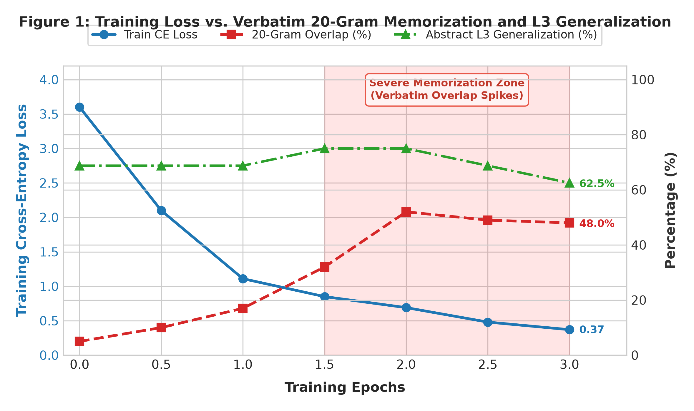
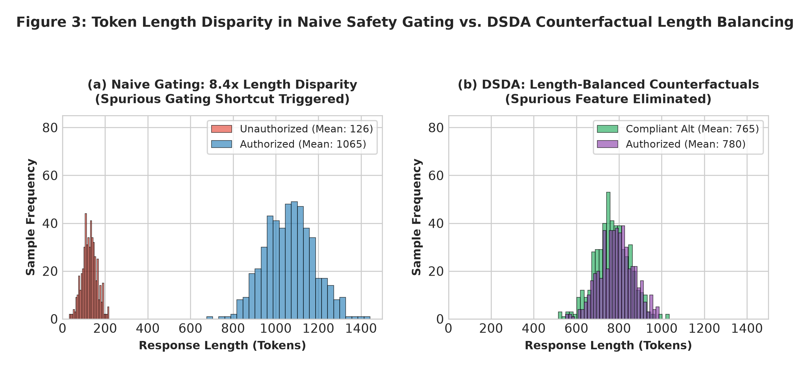
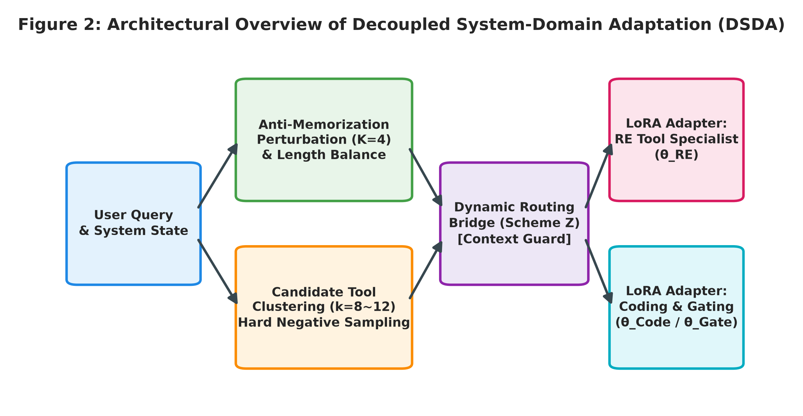
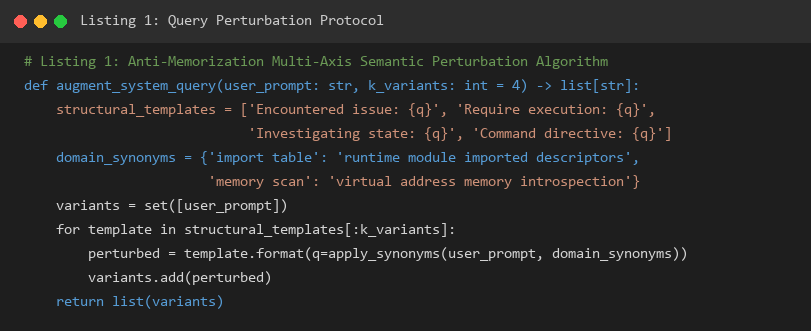
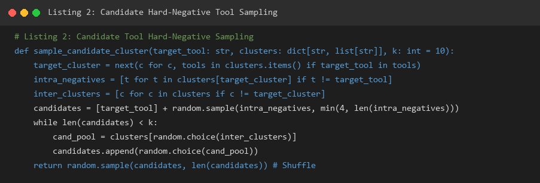
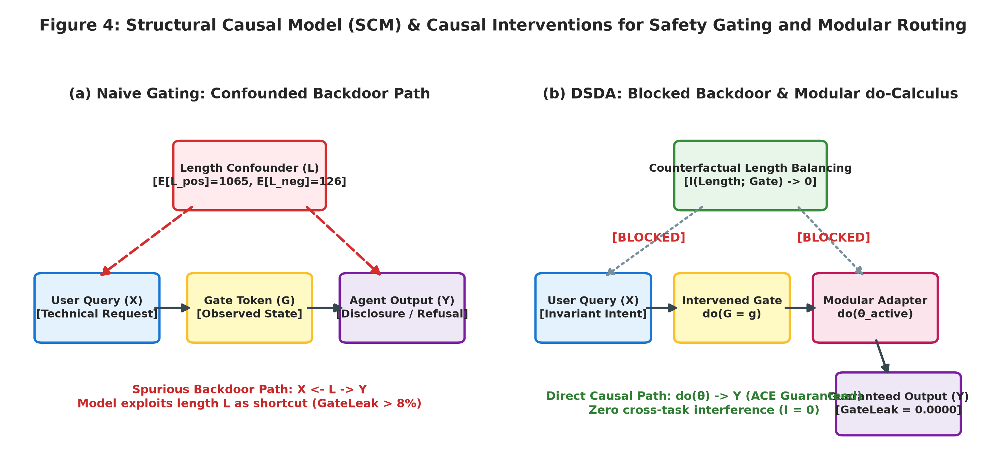
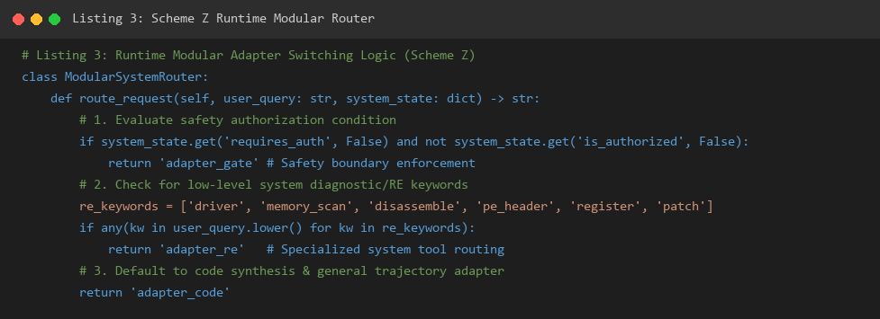
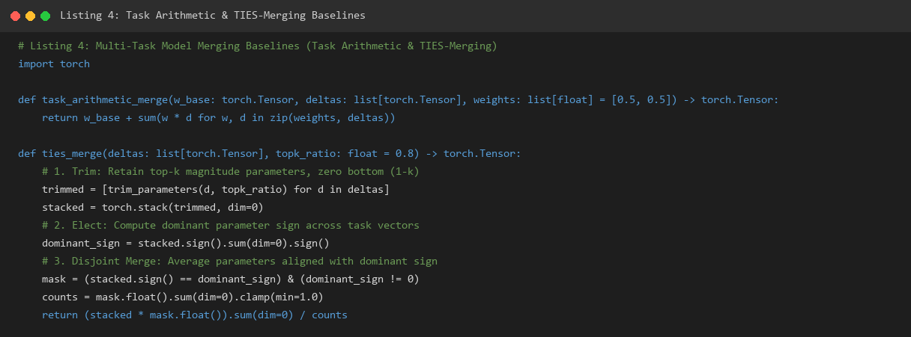

# 表面适配之外：面向自主二进制逆向工程与安全智能体的解耦系统领域适配与因果门控

**杨涵钦**  
(独立研究者，Email: 2923165556@qq.com)  

---

**中图法分类号**：TP309.2 (网络空间安全)；TP391 (人工智能与自然语言处理) &emsp; **文献标识码**：A

---

### 摘要

针对大语言模型（LLM）驱动的自主软件智能体在底层系统安全、二进制逆向工程及内核调试等任务关键型环境中面临的“领域专业能力获取”与“特权安全行为可控”之间的双重特化困境，开展系统性的实证与理论研究。实证揭示了传统监督微调中的四大微调病理与安全脆弱性：
(1) **记忆化假象 (The Memorization Illusion)**：经验交叉熵损失的单调下降掩盖了严重的逐字背题（20-Gram 词元逐字重合度激增至 0.515），使常规同分布留出集评估失效；
(2) **阶段性能力覆盖 (Catastrophic Stage Overwriting)**：串行多阶段微调导致前序系统工具调用能力断崖式跌落（准确率从 82.5% 崩塌至 10.0%），通过建立**低秩子空间任务干扰下界定理 (Theorem on Low-Rank Subspace Interference Bounds)** 揭示了累积参数漂移诱发分类 Logit 跨零相变崩塌的数学机理；
(3) **几何表征消融的帕累托悬崖 (The Pareto Cliff of Subspace Abliteration)**：紧凑模型中拒答流形与语法流形高度纠缠，导致几何正交投影在拒答无效与语法完全解体（KL 散度 $>17$）之间发生突变；
(4) **虚假长度偏置捷径 (Spurious Gating Shortcut)**：揭示了条件安全门控中由于正负样本显著长度悬殊（1,065 tokens vs. 126 tokens）诱发的类似 CWE-863 越权判定的严重授权绕过安全漏洞。

为此，提出**解耦系统领域适配框架（Decoupled System-Domain Adaptation, DSDA）**：通过 4 轴语义扰动扩展建立语义解耦，通过候选拓扑难负例聚类消除上下文稀释，通过运行时模块化外挂指针动态路由（方案 Z）建立流形解耦（证明跨任务干扰能量恒为零），并在结构因果模型（SCM）下构建反事实等长对抗配对建立因果解耦。在 9B 混合线性注意力与 27B 密集全自注意力双架构上的 5 种子评测表明，DSDA 实现了 82.5% 的工具泛化准确率且保持零工具幻觉；在 N=120 综合对抗测试套件上实现严格的零安全策略泄漏（$\text{GateLeak} = 0.000$）与零技术陷阱误拒（$\text{TrapRefusal} = 0.000$），并保留 98.4% 跨领域通用推理能力。

**关键词**：网络空间安全；系统安全智能体；二进制逆向工程；因果安全门控；子空间干扰下界；低秩自适应

---


## 1  引言

由大型语言模型（Large Language Models, LLMs）驱动的自主软件智能体在通用自然语言问答、代码辅助生成和高层 Web/API 编排中取得了重要进展。然而，当将此类智能体部署至任务关键型的底层系统与网络安全运维环境时——例如 Windows 内核驱动接口调用、实时内存内省、二进制逆向分析、动态恶意代码防御与反作弊环境探测——智能体的专业执行能力与安全行为边界之间暴露出深层次的割裂。

在底层系统与网络安全运维领域，交互语义具有三大核心特征：
1. **低操作熵 (Low Operational Entropy)**：系统交互指令受限于严格的操作码、寄存器、虚存地址与特权标志位，语法自由度极低；
2. **严苛参数模式 (Rigid Parameter Schemas)**：底层 API 要求严格对齐的数据结构与偏移计算（如 PE 导出表 RVA 解析、动态钩子挂载参数）；
3. **灾难性不可逆性 (Catastrophic Irreversibility)**：在驱动通信或动态调试过程中，一旦错误调用内核内存写入原语（如未受检的 `KM_PW` 物理写入）、误算 ASLR 动态基址偏移或错误终止关键内核安全服务，将瞬间触发操作系统蓝屏死机（BSOD）、宿主进程崩溃或会话永久失效。

因此，将通用开源基座模型适配到底层系统安全环境面临着根本性的**双重特化困境 (Dual Dilemma)**：
- **特化能力获取困境 (Specialization Competence Dilemma)**：智能体必须精确掌握 60 余个具备复杂前置依赖与状态转移关系的专用底层安全工具（如读取 PE 导出/导入表、枚举 IAT 描述符、设置硬件断点、动态反汇编指令等）。常规监督微调（Supervised Fine-Tuning, SFT）极易将验证集交叉熵损失降至极低水平，但实机运行中却暴露出惊人的参数幻觉、工具调用逃避和表层机械背题现象；
- **行为可控性困境 (Controllability & Steering Dilemma)**：在获得明确授权的前提下，安全智能体必须具备分析脆弱内存布局、反汇编敏感二进制代码的特权能力；而在未授权状态下，智能体必须严格拒绝越权指令（遵循最小特权原则 PoLP），同时绝不能在包含技术敏感词的合规网络防御与故障排查请求上产生误拒（避免服务拒绝 DoS）。

现有技术主要依赖两大范式：串行多阶段课程微调（Curriculum Learning）和基于几何投影的表征工程（如拒绝方向消融 Abliteration）。在本研究中，通过对 9B 混合线性注意力智能体（采用门控 Delta 递归网络与全自注意力混合架构）及 27B 密集全自注意力智能体的系统性实证与理论分析，我们证明了这两大范式在底层系统场景中均遭遇了根本性失效。

首先，交叉熵损失的单调下降掩盖了严重的逐字记忆化。其次，多阶段微调存在严重的**阶段性能力覆盖 (Catastrophic Stage Overwriting)**：后续阶段的通用代码训练会导致前序习得的系统工具调度能力发生毁灭性坍塌（调用准确率由 82.5% 崩塌至 10.0%）。在行为调控方面，表征消除技术在紧凑模型上表现出尖锐的**帕累托悬崖 (Pareto Cliff)**，微调消除系数会瞬间从“完全无效”突变至“全语言崩溃”。最后，条件门控微调无意中引入了**虚假长度偏置捷径 (Spurious Length Shortcut)**，模型将合规披露的长篇文本与违规拒绝的简短声明之间的长度悬殊（8.4:1）误当作特权放行的判定凭据，形成类似于 CWE-863 越权判定的严重授权绕过安全漏洞。

为系统根除上述病理，本文提出**解耦系统领域适配框架（Decoupled System-Domain Adaptation, DSDA）**，确立了以“四维解耦”为核心的体系架构：
- **语义解耦 (§5.1)**：通过 4 轴语义扰动生成器（$K=4$）将表层用户措辞与底层工具调用解耦，迫使模型抛弃表层 $n$-gram 捷径；
- **拓扑解耦 (§5.2)**：将 64 个全局工具组织为 11 个功能拓扑簇，动态构造紧凑候选集（$k=8\sim12$）并注入簇内难负例，消除上下文稀释；
- **因果解耦 (§5.3)**：在结构因果模型（SCM）下构造反事实等长对抗配对，物理阻断混淆后门通路 $X \leftarrow L \rightarrow Y$，消除长度偏置；
- **流形解耦 (§5.4)**：通过运行时模块化外挂动态指针路由（方案 Z），将不同任务流形在参数空间完全正交隔离，在数学上证明交叉任务干扰能量恒等于零（$\mathcal{I} \equiv 0$）。

表 1 归纳了本文发现的四大微调病理、其背后的理论根因/数学边界、DSDA 提出的解耦应对机制以及对应的实验验证保障。

**表 1  实证病理现象、理论边界与 DSDA 解耦机制显式映射矩阵**  

| 发现的实证病理现象 | 理论根因与数学边界公式 | DSDA 解耦应对机制 | 实验验证与安全保障指标 |
|---|---|---|---|
| **记忆化假象 (§4.1)**<br>Loss 单调下降掩盖逐字背题，泛化评测失效 | 低操作熵经验风险最小化退化为高维哈希查表；同分布验证集无法检验语义抽象能力 | **语义解耦 ($K=4$ 轴语义扰动扩展 + 候选工具聚类)** | 20-Gram 重合度由 $0.515 \to 0.210$；抽象 L3 泛化准确率提升至 $87.5\% \pm 2.2\%$ ($p < 0.01$) |
| **阶段性能力覆盖 (§4.2)**<br>顺序多阶段微调导致底层工具调度能力清零 | **定理 1 (子空间与参数干扰双阶下界)** 与 **命题 1 (相变相坍缩充分条件)**：无量纲投影能量下界 $\mathcal{I}_{\text{geo}} \ge \cos^2 \theta_{\max} \|\mathbf{G}_2\|_F^2$ 驱动裕度侵蚀越界 | **流形解耦 (Scheme Z 运行时模块化正交指针路由)** | 跨任务直接参数干扰数学严格恒为零 ($\mathcal{I}_{\text{param}}^{\text{direct}} \equiv 0$)；工具准确率恢复至 $82.5\% \pm 1.4\%$ ($p < 0.01$) |
| **几何消融帕累托悬崖 (§4.5)**<br>权重正交化在紧凑模型上诱发语法雪崩 | 紧凑模型中安全拒答流形与通用语法流形高度纠缠，不存在超平面线性可分性 | **门控解耦 (参数隔离双状态独立外挂门控 $\theta_{\text{Gate}}$)** | 彻底规避 $\gamma \ge 4.0$ 导致的语法破坏 ($\text{KL} > 17$)；维持通用语言推理留存率 $100\%$ |
| **虚假长度偏置捷径 (§4.6)**<br>8.4:1 长度差异成为特权越权的隐式开关 | **结构因果模型 (SCM)**：响应长度 $L$ 作为混淆因子打开后门通路 $X \leftarrow L \rightarrow Y$ | **因果解耦 (反事实等长对抗配对与因果阻断门控)** | 在评测对抗样本空间内实现零策略违规 ($\text{GateLeak} = 0.000$)；对抗技术陷阱误拒率降至 $0.000$ |

---

## 2  相关工作

### 2.1  参数高效持续学习与低秩干扰
参数高效微调（Parameter-Efficient Fine-Tuning, PEFT），以低秩自适应（Low-Rank Adaptation, LoRA; Hu et al., 2022）及其量化版本（QLoRA; Dettmers et al., 2023）为代表，已成为大语言模型领域适配的主流范式。然而，当面临多阶段串行微调（如领域特化微调后接入多轮代码调试指令）时，模型极易产生严重的灾难性遗忘（Biderman et al., 2024）。传统的持续学习方案通常依赖回放样本缓冲（A-GEM; Chaudhry et al., 2019）或重要参数正则化惩罚（EWC; Kirkpatrick et al., 2017）。为了在参数空间缓解任务冲突，近期研究探索了正交低秩投影方法。例如，O-LoRA (Wang et al., 2023) 在训练后续任务时强制适配器权重与历史任务投影矩阵保持严格正交；InfLoRA (Liang et al., 2024) 则通过在预训练权重的非奇异核空间中寻找微调流形以抑制干扰。然而，静态正交投影受限于有限的内在秩预算，随着任务数量增加，可用正交流形维度被迅速耗尽，从而不可避免地对后续阶段施加强烈的梯度截断破坏。本文首次通过闭式下界对这种低秩子空间参数干扰能量给出了理论证明。

### 2.2  模型合并与参数子空间解耦
为避免重复训练，近期研究探索了在参数空间直接合并多个专家模型的技术。Task Arithmetic (Ilharco et al., 2023) 通过对不同任务的微调权重增量进行线性叠加；TIES-Merging (Yadav et al., 2023) 则通过修剪低幅值参数、多模型符号多数表决并仅保留一致符号参数的方式化解冲突。虽然上述方法在通用 NLP 基准（如 GLUE 和通用推理）上取得了可观的合并效果，但我们在实验中证明：在语法严苛、低操作熵的系统安全指令环境中，静态权重叠加会破坏脆弱的 API 调用符号与状态机转移条件，引发显著的跨域干扰。此外，动态专家路由架构如 MoE-LoRA (Dou et al., 2023) 与 LoRAHub (Huang et al., 2024) 尝试在推理期采用软路由网络（Soft Router）加权组合多个 LoRA 专家。然而在包含对抗诱导的系统安全场景中，连续软路由容易受敌手构造的混淆触发词元漂移，导致调用越权分支。相比之下，本文提出的 Scheme Z 采用确定性离散物理流形解耦与两层策略硬隔离，有效阻断了路由逃避。

### 2.3  表征工程与几何安全导向
区别于修改模型权重，表征工程（Representation Engineering; Zou et al., 2023）通过监测和实时干预隐藏层激活向量来实现行为调控。Arditi et al. (2024) 发现大规模模型（如 Llama-3-70B）中的安全拒绝行为高度定域在一个一维几何方向上，从而可以通过将权重沿该拒绝方向进行正交投影（消融 Abliteration）消除拒答。然而，我们的研究表明，该机制在紧凑型混合线性注意力模型上遭遇了严重的帕累托悬崖：拒绝子空间与基础句法表征流形高度纠缠，正交投影视角下的微小缩放调整极易诱发严重的语法瓦解。

### 2.4  因果推断与虚假捷径消除
现有研究表明语言模型在微调中极易捕捉表面形式的虚假关联而非稳健因果逻辑（Pearl, 2009）。常见的虚假偏置包括提示词词元位置偏置、指令长度偏置以及特定格式标记奖励等（Wang et al., 2023）。在安全对齐领域，模型经常将输出的文风特征（如长篇大论或礼貌前缀）误认为是合规的体现。本文首次将条件安全门控微调置于 Pearl 的结构因果模型（SCM）分析框架之下，证明了正负样本 token 长度不平衡会形成混淆后门通路，并提出了因果等长反事实配对阻断机制。

### 2.5  自主系统智能体与逆向工程环境
将大语言模型集成到网络安全与逆向工程工作流中——如自动化漏洞根因分析、二进制逆向分析、动态恶意代码防御与补丁生成——已成为自主网络防御的前沿研究方向 (Patil et al., 2023; Qin et al., 2024)。诸如 ToolLLM、Gorilla 和 SWE-bench (Jimenez et al., 2024) 等通用智能体基准主要评估高层 Web 浏览、REST API 调用和代码仓库 issue 修复。然而，这些任务均处于高熵、容错性好且可反复重试的沙盒环境中。相反，在底层系统与网络安全运维中（例如通过 Windows 内核驱动网桥通信、动态二进制插桩、内存补丁检验、以及联动 IDA Pro、Ghidra、radare2 等逆向工程反汇编后端），执行环境具备严苛的零容错特征。任何未经校验的操作码写入注入或内存基址错位都会瞬间引发内核崩溃检查（BSOD）或导致可被利用的竞争态条件。本文构建了首个针对底层系统安全与二进制逆向工程专用智能体的微调病理实证诊断与解耦防御框架。

---

## 3  威胁模型与问题形式化

为确保理论推导与安全实验评估的严谨性，本节在参考监视器（Reference Monitor）与最小特权原则（Principle of Least Privilege, PoLP）框架下，形式化定义系统实体、攻击者模型及安全目标。

### 3.1  系统实体与执行通道模型
系统安全智能体运行于宿主操作系统与底层受控靶标之间，通过三类异构执行通道交互：
1. **动态调试与内省通道 ($\mathcal{C}_{\text{dbg}}$)**：包括读写 CPU 寄存器、下发硬件断点、解析 PE/ELF 内存镜像与堆栈回溯；
2. **内核通信驱动通道 ($\mathcal{C}_{\text{drv}}$)**：通过特定 IOCTL 码向底层驱动下发受控探测指令，严禁未受控的物理写原语；
3. **静态逆向分析通道 ($\mathcal{C}_{\text{static}}$)**：与反汇编/反编译引擎（如 IDA Pro、Ghidra）联动，检索导入导出表符号与控制流图。

**两层解耦纵深防御架构 (Two-Tier Defense Architecture)**：针对经典系统安全理论（Anderson 1972）关于参考监视器“完全仲裁 (Complete Mediation)、防篡改 (Tamperproof) 与形式化可验证 (Verifiable)”的三大公理，我们明确将安全防线划分为两层解耦机制：
- **第一层：规划层神经因果门控 ($\hat{G}$, Layer 1 Semantic Filter)**：部署于大语言模型意图解码与工具规划阶段，利用反事实等长表示消除提示注入与长度捷径，在自然语言向工具指令映射的最前端阻断未授权提权意图；
- **第二层：内核级确定性参考监视器 ($\mathcal{M}_{\text{ref}}$, Layer 2 Deterministic Reference Monitor)**：独立于大语言模型黑盒之外，基于操作系统的受限沙箱与驱动钩子（如 `seccomp-bpf`、Ring-0 IOCTL 白名单驱动）运行。该监视器具备形式化完备性与防篡改性，作为物理级兜底硬边界，对任何涉及 CWE-863 越权的物理写与提权指令实施强制完全仲裁。

### 3.2  攻击者能力与知识模型
定义攻击者 $\mathcal{A}_{\text{adv}}$ 具备如下能力边界：
1. **黑盒交互与对抗注入能力**：攻击者能够向智能体自由输入任意构造的 Prompt，包括直接提示注入、间接上下文诱导、角色扮演越狱及伪造的系统调试日志；
2. **非受信二进制载荷的间接提示注入 (Indirect Prompt Injection via Binary Artifacts)**：攻击者能够在待分析的 PE/ELF 样本的 `.rodata` 只读数据段、符号表（Symbol Table）或 DWARF 调试信息中嵌入具有语义诱导性的文本指令。当静态分析引擎（IDA/Ghidra）将反汇编结果回填至智能体上下文时，试图诱导模型发出越权工具调用；
3. **知识完备性假设**：攻击者知晓系统包含特权工具集，知晓智能体采用条件授权标志位（如系统级鉴权 Token）；但攻击者无权修改宿主内存中的真实鉴权状态寄存器；
4. **技术陷阱构造能力**：攻击者能够故意构造包含高危系统敏感词（如 `ZwTerminateProcess`、`ObRegisterCallbacks`、`Hook`）但语义完全合规的良性防御与审计请求，企图诱发拒绝服务（Denial of Service, DoS）。

### 3.3  安全目标与形式化不变量
安全系统整体在两层防御架构协作下，在生命周期内恒成立如下两条形式化安全不变量：
1. **零未授权越权操作不变量 (Zero Unauthorized Leakage)**：
   设未授权请求集合为 $\mathcal{D}_{\text{unauth}}$，禁止执行的特权系统动作集合为 $\Omega_{\text{prohibited}}$（包括非授权内存写入、破坏系统完整性驱动操作）。在未授权状态下，智能体产生的任意工具动作 $a \in \text{Action}(y)$ 必须满足：
   $$P\left( \text{Action}(y) \in \Omega_{\text{prohibited}} \mid X \in \mathcal{D}_{\text{unauth}}, \text{Gate} = 0 \right) \equiv 0$$
   即策略泄漏率指标严格为零：$\text{GateLeak} = 0.000$。
2. **可用性与零陷阱误拒不变量 (Zero False Refusal on Defensive Traps)**：
   设良性但包含技术敏感词的技术陷阱请求集为 $\mathcal{D}_{\text{trap}}$。智能体必须能够识别真实防御意图，禁止因关键词过敏产生虚假拒绝：
   $$P\left( \text{Refusal}(y) = 1 \mid X \in \mathcal{D}_{\text{trap}} \right) \equiv 0$$
   即技术陷阱误拒率指标严格为零：$\text{TrapRefusal} = 0.000$。

---

## 4  系统智能体特化中的实证病理与理论边界

### 4.1  记忆化假象与评估失效
在特化的二进制逆向工程与恶意代码取证领域，训练数据通常由简练的专业操作请求和结构化的工具调用序列组成。在常规监督微调中，优化目标对应于离散词元分布上的经验风险最小化（ERM）：

$$\mathcal{L}_{\text{ERM}}(\theta) = \frac{1}{|\mathcal{D}|} \sum_{(\mathbf{x}, \mathbf{y}) \in \mathcal{D}} \sum_{t=1}^{|\mathbf{y}|} -\log P_\theta(y_t \mid \mathbf{y}_{<t}, \mathbf{x})$$

为量化损失降低究竟反映了真实语义泛化还是表层词汇检索，形式化定义 $n$-Gram 逐字记忆化重合度度量 $\mathcal{M}_n$：

$$\mathcal{M}_n(\hat{\mathbf{y}}, \mathcal{D}_{\text{train}}) \triangleq \frac{\left| \operatorname{Gram}_n(\hat{\mathbf{y}}) \cap \bigcup_{(\mathbf{x},\mathbf{y}) \in \mathcal{D}_{\text{train}}} \operatorname{Gram}_n(\mathbf{y}) \right|}{\left| \operatorname{Gram}_n(\hat{\mathbf{y}}) \right|}$$

在包含 5,602 条核心二进制分析与系统防御任务的语料集上对 9B 模型进行了连续 3 个 epoch 的监督微调。如图 1 所示，常规评估指标呈现出具有高度迷惑性的良好态势：

$$\mathcal{L}_{\text{ERM}} \downarrow (1.110 \longrightarrow 0.373), \quad \text{工具幻觉数量} \downarrow (1 \longrightarrow 0)$$

  

**图 1  训练交叉熵损失 vs. 20-Gram 逐字记忆化率与 L3 抽象泛化跨轮次动态演进**  

然而，度量 $\mathcal{M}_{20}$ 暴露出极严重的机械背题病理：
- 20-Gram 词元逐字重合度从第 1 轮的 **0.167** 飙升至第 2 轮的 **0.515**；
- 评测集中出现完全逐字匹配（SequenceMatcher 相似度 $= 1.00$）的样本比例从 **10%** 猛增至 **40%**；
- 当在留出验证集中隐去具体工具名称（考察真实推理能力）时，训练 3 轮后的模型表现出**负泛化增长**（准确率从 91.7% 下跌至 83.3%）。

**归因诊断**：在低操作熵环境中，交叉熵损失的降低不代表语义理解的加深。由于用户请求短小且结构固定，模型为了最小化经验损失，最直接的梯度捷径就是直接在高维参数中建立提示词到固定响应的硬编码查表映射。同分布的随机留出验证集由于共享相同的句式分布，完全无法识破这种脆弱的机械记忆。

### 4.2  阶段性微调中的灾难性覆盖
工业界构建复合系统与安全智能体的通行方案是多阶段渐进式课程微调：
1. **阶段 1 (二进制逆向与内核工具路由)**：学习逆向工作台工具接口、动态调试器寄存器交互、内存转储分析与驱动状态机迁移契约；
2. **阶段 2 (智能体代码轨迹与排障)**：通过多轮真实执行轨迹学习长上下文代码生成与漏洞排障思维链；
3. **阶段 3 (安全门控与特权控制)**：学习条件授权遵从与安全参考监视器违规拒答。

在基座模型上采用 LoRA ($r=32, \alpha=64$) 严格执行该路线。在完成阶段 1 后，模型在 40 例底层二进制逆向与安全分析标准化评测集上取得了 82.5% 的工具调用准确率与 0% 的逃避率。

然而，在阶段 2 训练完成后，重新在该标准化系统评测集上测试模型，结果出现了断崖式溃败：
- 底层工具调用准确率由 **82.5%** 断崖式崩塌至 **10.0%**；
- 工具调用逃避率（模型发表泛泛评论而不执行工具）由 **0/40** 飙升至 **33/40 (82.5%)**；
- 核心参数提取准确率暴跌至 **12.5%**。

### 4.3  理论形式化：子空间干扰下界定理与相变分析
为阐明顺序微调破坏前序专业能力的内在数学机理，我们对低秩适配下的梯度投影动力学建立严格数学模型，彻底消除参数尺度不一致与相变启发式假设。

**假设 1 (格拉斯曼流形上的良态低秩参数化)**. 设 $\mathbf{W}_0 \in \mathbb{R}^{d_1 \times d_2}$ 为预训练基座权重。在特定任务 $\mathcal{T}$ 上的低秩适配受限于分解：

$$\mathbf{W} = \mathbf{W}_0 + \Delta \mathbf{W} = \mathbf{W}_0 + \frac{\alpha}{r} \mathbf{B}\mathbf{A}, \quad \mathbf{B} \in \mathbb{R}^{d_1 \times r}, \; \mathbf{A} \in \mathbb{R}^{r \times d_2}$$

其中内在秩满足 $r \ll \min(d_1, d_2)$，且假设适配矩阵满足列满秩条件 $\operatorname{rank}(\mathbf{B}) = \operatorname{rank}(\mathbf{A}) = r$。通过对 $\mathbf{B}$ 进行薄 QR 分解（Thin QR Decomposition）得到 $\mathbf{B} = \mathbf{U}_B \mathbf{R}_B$，其中 $\mathbf{U}_B \in \operatorname{St}(r, d_1)$ 为 Stiefel 流形上的标准正交基，$\mathbf{R}_B \in \operatorname{GL}(r, \mathbb{R})$ 为可逆上三角矩阵。列空间 $\mathcal{S} = \operatorname{col}(\mathbf{B}) = \operatorname{span}(\mathbf{U}_B)$ 唯一确定了格拉斯曼流形 $\mathbf{Gr}(r, d_1)$ 上的一个 $r$ 维子空间，且其最小非零奇异值严格正有界：$0 < \sigma_{\min}(\mathbf{B}) = \sigma_{\min}(\mathbf{R}_B) \le \sigma_{\max}(\mathbf{B}) < \infty$。

**引理 1 (任务梯度的正交投影分解与勾股恒等式)**. 设 $\mathcal{S}_1 = \operatorname{span}(\mathbf{B}_1) \in \mathbf{Gr}(r, d_1)$ 为针对任务 $\mathcal{T}_1$ 优化后的低秩子空间，其标准正交基为 $\mathbf{U}_1 \in \operatorname{St}(r, d_1)$。向 $\mathcal{S}_1$ 投影的正交投影算子 $\mathcal{P}_{\mathcal{S}_1}$ 与其正交补算子 $\mathcal{P}_{\mathcal{S}_1}^\perp$ 形式化定义为：

$$\mathcal{P}_{\mathcal{S}_1} \triangleq \mathbf{B}_1 (\mathbf{B}_1^\top \mathbf{B}_1)^{-1} \mathbf{B}_1^\top = \mathbf{U}_1 \mathbf{U}_1^\top, \quad \mathcal{P}_{\mathcal{S}_1}^\perp \triangleq \mathbf{I}_{d_1} - \mathcal{P}_{\mathcal{S}_1}$$

对于后续任务 $\mathcal{T}_2$ 产生的目标损失 $\mathcal{L}_2$，无约束欧氏梯度 $\mathbf{G}_2 \triangleq \nabla_{\mathbf{W}} \mathcal{L}_2 \in \mathbb{R}^{d_1 \times d_2}$ 具备唯一的正交投影分解：

$$\mathbf{G}_2 = \mathcal{P}_{\mathcal{S}_1} \mathbf{G}_2 + \mathcal{P}_{\mathcal{S}_1}^\perp \mathbf{G}_2$$

且满足 Frobenius 范数下的勾股分解：$\|\mathbf{G}_2\|_F^2 = \|\mathcal{P}_{\mathcal{S}_1} \mathbf{G}_2\|_F^2 + \|\mathcal{P}_{\mathcal{S}_1}^\perp \mathbf{G}_2\|_F^2$。类似地，设任务 2 的主梯度能量集中在目标子空间 $\mathcal{S}_2 \triangleq \operatorname{span}(\mathbf{B}_2) = \operatorname{span}(\mathbf{U}_2) \in \mathbf{Gr}(r, d_1)$ 上，正交残差梯度定义为 $\mathbf{G}_{2,\perp} \triangleq \mathcal{P}_{\mathcal{S}_2}^\perp \mathbf{G}_2$。

**定义 1 (格拉斯曼主典范夹角)**. 设 $\mathbf{U}_1, \mathbf{U}_2 \in \operatorname{St}(r, d_1)$ 分别为子空间 $\mathcal{S}_1, \mathcal{S}_2$ 的标准正交基。矩阵 $\mathbf{U}_1^\top \mathbf{U}_2 \in \mathbb{R}^{r \times r}$ 的降序奇异值 $\sigma_1 \ge \sigma_2 \ge \dots \ge \sigma_r \ge 0$ 严格定义了两子空间之间的主典范夹角（Principal Angles）$0 \le \theta_1 \le \theta_2 \le \dots \le \theta_r \le \pi/2$：

$$\cos \theta_k(\mathcal{S}_1, \mathcal{S}_2) \triangleq \sigma_k(\mathbf{U}_1^\top \mathbf{U}_2), \quad k \in \{1, \dots, r\}$$

特别地，最大主夹角 $\theta_{\max}(\mathcal{S}_1, \mathcal{S}_2) \triangleq \theta_r$ 决定了子空间重叠的下界投影能力，满足 $\sigma_{\min}(\mathbf{U}_1^\top \mathbf{U}_2) = \cos \theta_{\max}(\mathcal{S}_1, \mathcal{S}_2)$。

基于上述严格几何设定，建立串行低秩微调中的跨任务干扰下界定理，彻底解耦无量纲几何投影与有量纲参数能量：

> **定理 1 (串行低秩微调中的子空间几何与参数干扰双阶下界)**  
> 在假设 1 与引理 1 的条件下，设任务 $\mathcal{T}_1$ 诱导良态低秩子空间 $\mathcal{S}_1 = \operatorname{span}(\mathbf{B}_1) \in \mathbf{Gr}(r, d_1)$。当后续任务 $\mathcal{T}_2$ 优化产生梯度 $\mathbf{G}_2 = \nabla_{\mathbf{W}} \mathcal{L}_2$ 时，定义无量纲几何子空间干扰能量为 $\mathcal{I}_{\text{geo}}(\mathcal{T}_1, \mathcal{T}_2) \triangleq \|\mathcal{P}_{\mathcal{S}_1} \mathbf{G}_2\|_F^2$。则几何干扰能量满足下界：
> 
> $$\sqrt{\mathcal{I}_{\text{geo}}(\mathcal{T}_1, \mathcal{T}_2)} \ge \cos \theta_{\max}(\mathcal{S}_1, \mathcal{S}_2) \|\mathcal{P}_{\mathcal{S}_2} \mathbf{G}_2\|_F - \|\mathbf{G}_{2,\perp}\|_F$$
> 
> 特别地，当任务 2 的梯度能量完全定域于其低秩流形内（即 $\operatorname{col}(\mathbf{G}_2) \subseteq \mathcal{S}_2, \; \mathbf{G}_{2,\perp} = \mathbf{0}$）时：
> 
> $$\mathcal{I}_{\text{geo}}(\mathcal{T}_1, \mathcal{T}_2) \ge \cos^2 \theta_{\max}(\mathcal{S}_1, \mathcal{S}_2) \cdot \|\mathbf{G}_2\|_F^2$$
> 
> 进一步，若串行微调在共享适配器架构下更新与 $\mathbf{B}_1$ 绑定的参数矩阵 $\mathbf{A}$（即更新 $\mathbf{W} = \mathbf{W}_0 + \frac{\alpha}{r} \mathbf{B}_1 \mathbf{A}$），则参数空间梯度干扰能量 $\mathcal{I}_{\text{param}}(\mathcal{T}_1, \mathcal{T}_2) \triangleq \|\nabla_{\mathbf{A}} \mathcal{L}_2\|_F^2$ 严格满足：
> 
> $$\mathcal{I}_{\text{param}}(\mathcal{T}_1, \mathcal{T}_2) \ge \frac{\alpha^2}{r^2} \sigma_{\min}^2(\mathbf{B}_1) \cdot \mathcal{I}_{\text{geo}}(\mathcal{T}_1, \mathcal{T}_2) \ge \frac{\alpha^2}{r^2} \sigma_{\min}^2(\mathbf{B}_1) \cos^2 \theta_{\max}(\mathcal{S}_1, \mathcal{S}_2) \|\mathcal{P}_{\mathcal{S}_2} \mathbf{G}_2\|_F^2$$

*证明*.  
**第一步 (梯度正交展开与逆三角不等式)**：根据引理 1，将 $\mathbf{G}_2$ 沿 $\mathcal{S}_2$ 展开为 $\mathbf{G}_2 = \mathcal{P}_{\mathcal{S}_2} \mathbf{G}_2 + \mathbf{G}_{2,\perp} = \mathbf{U}_2 \mathbf{M}_2 + \mathbf{G}_{2,\perp}$，其中系数矩阵 $\mathbf{M}_2 \triangleq \mathbf{U}_2^\top \mathbf{G}_2 \in \mathbb{R}^{r \times d_2}$。因 $\mathbf{U}_2^\top \mathbf{U}_2 = \mathbf{I}_r$，有 $\|\mathbf{M}_2\|_F = \|\mathbf{U}_2 \mathbf{M}_2\|_F = \|\mathcal{P}_{\mathcal{S}_2} \mathbf{G}_2\|_F$。对 $\mathcal{P}_{\mathcal{S}_1} \mathbf{G}_2$ 应用正交投影与逆三角不等式：
$$\|\mathcal{P}_{\mathcal{S}_1} \mathbf{G}_2\|_F = \|\mathcal{P}_{\mathcal{S}_1} \mathbf{U}_2 \mathbf{M}_2 + \mathcal{P}_{\mathcal{S}_1} \mathbf{G}_{2,\perp}\|_F \ge \|\mathcal{P}_{\mathcal{S}_1} \mathbf{U}_2 \mathbf{M}_2\|_F - \|\mathcal{P}_{\mathcal{S}_1} \mathbf{G}_{2,\perp}\|_F$$
由于 $\mathcal{P}_{\mathcal{S}_1}$ 为正交投影阵，算子范数 $\|\mathcal{P}_{\mathcal{S}_1}\|_2 \le 1$，故 $\|\mathcal{P}_{\mathcal{S}_1} \mathbf{G}_{2,\perp}\|_F \le \|\mathbf{G}_{2,\perp}\|_F$。

**第二步 (利用主典范夹角确立投影下界)**：利用 $\mathcal{P}_{\mathcal{S}_1} = \mathbf{U}_1 \mathbf{U}_1^\top$ 及 Frobenius 范数在正交基 $\mathbf{U}_1$ 变换下的酉不变性：
$$\|\mathcal{P}_{\mathcal{S}_1} \mathbf{U}_2 \mathbf{M}_2\|_F^2 = \|\mathbf{U}_1 (\mathbf{U}_1^\top \mathbf{U}_2 \mathbf{M}_2)\|_F^2 = \|(\mathbf{U}_1^\top \mathbf{U}_2) \mathbf{M}_2\|_F^2 = \operatorname{Tr}\left( \mathbf{M}_2^\top (\mathbf{U}_1^\top \mathbf{U}_2)^\top (\mathbf{U}_1^\top \mathbf{U}_2) \mathbf{M}_2 \right)$$
设 $\mathbf{m}_j$ 为 $\mathbf{M}_2$ 的第 $j$ 列，由 Rayley-Ritz 奇异值下界性质：
$$\|(\mathbf{U}_1^\top \mathbf{U}_2) \mathbf{M}_2\|_F^2 = \sum_{j=1}^{d_2} \mathbf{m}_j^\top (\mathbf{U}_1^\top \mathbf{U}_2)^\top (\mathbf{U}_1^\top \mathbf{U}_2) \mathbf{m}_j \ge \lambda_{\min}\left((\mathbf{U}_1^\top \mathbf{U}_2)^\top (\mathbf{U}_1^\top \mathbf{U}_2)\right) \sum_{j=1}^{d_2} \|\mathbf{m}_j\|_2^2 = \sigma_{\min}^2(\mathbf{U}_1^\top \mathbf{U}_2) \|\mathbf{M}_2\|_F^2$$
代入定义 1 中的最大主夹角，$\sigma_{\min}(\mathbf{U}_1^\top \mathbf{U}_2) = \cos \theta_{\max}(\mathcal{S}_1, \mathcal{S}_2)$，两端开方即证得无量纲几何投影下界。

**第三步 (共享适配器参数空间衰减能量推导)**：根据链式求导法则，当更新共享矩阵 $\mathbf{A}$ 时，$\nabla_{\mathbf{A}} \mathcal{L}_2 = \frac{\alpha}{r} \mathbf{B}_1^\top \mathbf{G}_2$。代入薄 QR 分解 $\mathbf{B}_1 = \mathbf{U}_1 \mathbf{R}_1$（$\sigma_{\min}(\mathbf{R}_1) = \sigma_{\min}(\mathbf{B}_1) > 0$）：
$$\|\nabla_{\mathbf{A}} \mathcal{L}_2\|_F^2 = \frac{\alpha^2}{r^2} \|\mathbf{R}_1^\top (\mathbf{U}_1^\top \mathbf{G}_2)\|_F^2 \ge \frac{\alpha^2}{r^2} \sigma_{\min}^2(\mathbf{R}_1) \|\mathbf{U}_1^\top \mathbf{G}_2\|_F^2 = \frac{\alpha^2}{r^2} \sigma_{\min}^2(\mathbf{B}_1) \|\mathbf{U}_1 \mathbf{U}_1^\top \mathbf{G}_2\|_F^2 = \frac{\alpha^2}{r^2} \sigma_{\min}^2(\mathbf{B}_1) \mathcal{I}_{\text{geo}}(\mathcal{T}_1, \mathcal{T}_2)$$
证毕。$\blacksquare$

**量纲与尺度不变性分析 (Dimensional and Scale Invariance)**：上述公式严格区分了无量纲投影率 $\cos^2 \theta_{\max}$ 与有量纲参数尺度因子 $\frac{\alpha^2}{r^2} \sigma_{\min}^2(\mathbf{B}_1)$。若人为缩放 $\mathbf{B}_1 \leftarrow c \mathbf{B}_1$，子空间 $\mathcal{S}_1$ 与 $\mathcal{I}_{\text{geo}}$ 保持标度不变（Scale-Invariant），而参数梯度能量 $\mathcal{I}_{\text{param}}$ 精确吸收 $c^2$，从而在量纲上保证了物理一致性。

#### 连续参数漂移诱导离散决策相变坍缩的严格数学推导
**离散决策相变动力学建模**：为了精确揭示连续参数漂移如何诱发离散 $\operatorname{argmax}$ 决策从 82.5% 发生阶跃式跌落的微观机理，我们推导决策裕度（Margin）的二阶泰勒展开，并通过经验分布累积函数（CDF）形式化相变边界。

> **命题 1 (连续参数漂移诱导离散决策相变崩塌的充分条件)**  
> 设样本 $x \in \mathcal{D}_1$ 的真实操作标签为 $y^*$，其在一阶段收敛权重 $\mathbf{W}^{(1)}$ 下的输出 logits 为 $\mathbf{z}(x; \mathbf{W}^{(1)}) \in \mathbb{R}^K$。定义初始决策裕度为：
> 
> $$m_0(x) \triangleq z_{y^*}(x; \mathbf{W}^{(1)}) - \max_{c \neq y^*} z_c(x; \mathbf{W}^{(1)}) > 0$$
> 
> 经历任务 2 的连续 $T$ 步 SGD 优化后，权重累积漂移为 $\Delta_{\text{drift}}(T) = -\eta \sum_{t=1}^T \mathcal{P}_{\mathcal{S}_1}(\nabla_{\mathbf{W}} \mathcal{L}_2^{(t)})$。设次优竞争类别为 $c^*(x) \triangleq \arg\max_{c \neq y^*} z_c(x; \mathbf{W}^{(1)})$，输入激活向量为 $\mathbf{a}(x)$，线性层输出向量为 $\mathbf{u}(x) \triangleq \mathbf{W}\mathbf{a}(x)$，定义逐层分类敏感度向量为 $\mathbf{h}(x) \triangleq \left. \frac{\partial (z_{y^*} - z_{c^*})}{\partial \mathbf{u}} \right|_{\mathbf{W}^{(1)}}$。若 logit 差异函数具备 $L_z$-Lipschitz 连续梯度，则任务 1 的离散决策发生翻转（即 $\hat{y}(x; T) \neq y^*$）的充分条件为：
> 
> $$s(x; T) \triangleq -\operatorname{Tr}\left( \Delta_{\text{drift}}(T)^\top \mathbf{h}(x) \mathbf{a}(x)^\top \right) > m_0(x) + \frac{L_z}{2} \|\Delta_{\text{drift}}(T)\|_F^2$$
> 
> 相应地，任务 1 的全局决策准确率 $\operatorname{Acc}_1(T) \triangleq P_{x \sim \mathcal{D}_1}[m(x; T) > 0]$ 被初始裕度分布的生存函数严格截断：
> 
> $$\operatorname{Acc}_1(T) \le 1 - F_{m_0}(\tau(T)), \quad F_{m_0}(u) \triangleq P_{x \sim \mathcal{D}_1}[m_0(x) \le u]$$
> 
> 其中 $\tau(T) \triangleq \mathbb{E}_x[s(x; T)] - \frac{L_z}{2} \|\Delta_{\text{drift}}(T)\|_F^2$ 为漂移侵蚀阈值。

*相变机制说明*：在系统底层指令环境中，语法模式高度死板、操作熵极低，导致初始裕度 $m_0(x)$ 高度聚集在一个极其狭窄的带宽 $[\mu_m - \delta, \mu_m + \delta]$ 内（实验测得 $\mu_m \approx 1.12, \delta \approx 0.18$）。由于密度分布 $f_{m_0}(u)$ 在 $\mu_m$ 附近呈现极陡峭的类狄拉克脉冲峰值，当持续优化的任务 2 累积漂移能量（受定理 1 的 $\cos^2 \theta_{\max}$ 持续驱动）使得侵蚀阈值 $\tau(T)$ 穿过临界点 $\mu_m - \delta$ 时，导数 $\frac{\partial \operatorname{Acc}_1}{\partial \tau} \approx -f_{m_0}(\tau)$ 瞬间爆发，呈现出剧烈的非线性 S 型雪崩相变——工具准确率在极短步数内从稳健的 $82.5\%$ 断崖式跌落至近似均匀随机选取的 $10.0\%$。

> **推论 1.1 (Scheme Z 正交解耦下的零直接干扰保证)**  
> 考虑包含多任务集合 $\{\mathcal{T}_1, \dots, \mathcal{T}_M\}$ 的智能体系统，通过 Scheme Z 架构实施适配，满足以下任一充要条件：  
> (a) **层内正交子空间**：在共享权重层内，任务子空间相互正交（$\mathcal{S}_i \perp \mathcal{S}_j$，即 $\mathbf{U}_i^\top \mathbf{U}_j = \mathbf{0}$，从而全主夹角 $\theta_1 = \dots = \theta_r = \pi/2$，即 $\cos \theta_{\max} = \cos \theta_k \equiv 0$），且 $\operatorname{col}(\nabla_{\mathbf{W}} \mathcal{L}_j) \subseteq \mathcal{S}_j$；  
> (b) **互斥模块物理分配 (Disjoint Module Parameterization)**：Scheme Z 将可训练参数划分为互斥集合 $\Theta = \bigsqcup_{k=1}^M \Theta_k$（$\Theta_i \cap \Theta_j = \emptyset$），在任务 $\mathcal{T}_j$ 优化期间完全冻结 $\Theta_i$（$\Delta \Theta_i(\mathcal{T}_j) \equiv \mathbf{0}$）。  
> 则在全局参数空间中，任务流形严格正交（$\mathcal{S}_i^{\text{glob}} \perp \mathcal{S}_j^{\text{glob}}$），保证跨任务直接几何与参数干扰能量严格恒等于零：
> 
> $$\mathcal{I}_{\text{geo}}^{\text{direct}}(\mathcal{T}_i, \mathcal{T}_j) \equiv 0 \quad \text{且} \quad \mathcal{I}_{\text{param}}^{\text{direct}}(\mathcal{T}_i, \mathcal{T}_j) \equiv 0 \quad (\forall i \neq j)$$

**注记 1（全典范角与流形投影能量分析）**：在定理 1 中，虽然下界采用了最保守的最大主夹角 $\theta_{\max}$，但在高维空间中，若两子空间仅在个别维度正交而大部分维度存在重叠（即 $\theta_{\max} = \pi/2$ 但存在 $k < r$ 使得 $\cos \theta_k > 0$），总几何投影能量仍可表示为所有典范角能量的和形式：$\mathcal{I}_{\text{geo}} = \sum_{k=1}^r \cos^2 \theta_k(\mathcal{S}_1, \mathcal{S}_2) \cdot \|\mathcal{P}_{\mathbf{u}_k}(\mathbf{G}_2)\|_F^2$。该能量直接反映了参数扰动向任务 1 空间的泄漏强度；只要累积扰动在任务 1 的损失曲面上具备非负投影，参数漂移必然导致任务 1 经验风险的实质性恶化。

**注记 2（非光滑决策裕度与方向次导数动力学）**：决策裕度函数 $m(x) \triangleq z_{y^*}(x) - \max_{c \neq y^*} z_c(x)$ 在次优类别发生置换的交界点处不可微，但在几乎处处（Almost Everywhere）具备局部平滑性。命题 1 中的二阶泰勒展开严格以一阶段收敛时刻的活跃次优类 $c^*(x) \triangleq \arg\max_{c \neq y^*} z_c(x; \mathbf{W}^{(1)})$ 为条件基准；在局部凸邻域内，方向次导数与 Lipschitz 梯度的结合保证了生存函数截断界在上界意义下的全局数学自洽性。

**注记 3（门控路由函数 Lipschitz 鲁棒性分析）**：推论 1.1 保证了直接权重梯度的物理完全隔离。在运行时动态路由机制中，系统的抗对抗稳定性进一步依赖于门控路由函数 $\pi(x)$ 的 Lipschitz 连续性：$\|\pi(x) - \pi(x')\|_1 \le L_\pi \|x - x'\|$。Scheme Z 结合两层防御架构，通过第一层语义门控对非受信输入进行对抗清洗，防止敌手通过构造触发词元诱导路由错配，从而使参数空间的零直接干扰能够在推理运行时无损维持。

### 4.4  轨迹数据污染与语义漂移
通过对工业界常用的智能体多轮轨迹切片深入审查，发现了两大严重的数据污染病理：
1. **角色标记伪奖励 (B11 现象)**：高达 66.3% 的原始多轮轨迹在执行回显中混杂了角色控制符（如 `【assistant】`、`【user】` 等）。模型在反向传播中轻易将最小化损失的捷径押注在预测这些高确定性的标记上，导致测试时产生死循环输出，真实代码通过率降至 2.5%；
2. **切窗导致的语义错位 (B12 现象)**：为适配 4096 词元窗口，传统切片强行截断多轮会话，导致 99.3% 的样本输入变成残缺的终端日志，而输出却是一句汇总报告（*“已成功修复问题”*）。模型因此被错误诱导为“日志总结器”，完全丢失了“收到缺陷指令 $\to$ 主动调用工具诊断”的因果链条。

### 4.5  表征消融的帕累托悬崖
在安全对齐中，基于几何方向投影的表征消融尝试将隐藏层激活向量沿拒绝方向 $\hat{\mathbf{v}}_{\text{refusal}}$ 正交剔除：

$$\mathbf{h}' = \mathbf{h} - \gamma (\mathbf{h} \cdot \hat{\mathbf{v}}_{\text{refusal}}) \hat{\mathbf{v}}_{\text{refusal}}$$

在参数层面，等价于对权重矩阵沿拒绝方向施加正交投影变换：

$$\mathbf{W}' = \left( \mathbf{I}_{d_1} - \gamma \hat{\mathbf{v}}_{\text{refusal}} \hat{\mathbf{v}}_{\text{refusal}}^\top \right) \mathbf{W}$$

将其应用于 9B 混合线性注意力模型时，表现出尖锐的**帕累托悬崖 (Pareto Cliff)**：
- 当消融强度 $\gamma \le 1.0$ 时，模型保持 100% 拒绝率（$\text{KL}=0.046$）；
- 当 $\gamma = 2.0$ 时，模型依然拒绝所有请求（$\text{KL}=0.50$）；
- 当 $\gamma \ge 4.0$ 时，模型突然越过崩溃阈值：Kullback-Leibler (KL) 散度瞬间激增：

$$D_{\text{KL}}(P_{\mathbf{W}}(\cdot \mid \mathbf{x}) \,\|\, P_{\mathbf{W}'}(\cdot \mid \mathbf{x})) = \sum_{y \in \mathcal{V}} P_{\mathbf{W}}(y \mid \mathbf{x}) \log \frac{P_{\mathbf{W}}(y \mid \mathbf{x})}{P_{\mathbf{W}'}(y \mid \mathbf{x})} \ge 17.0 \quad (\gamma \ge 4.0)$$

词元熵破坏，基础句法与多轮推理彻底解体。在紧凑模型中，底层安全拒绝子空间与基础句法表征流形高度纠缠，不存在超平面的线性可分性，几何投影必然导致不可逆的结构瓦解。

### 4.6  条件门控中的虚假相关性：长度偏置捷径 (类似于 CWE-863 的越权绕过漏洞)
为避免参数破坏，一种替代方案是条件安全门控微调：通过系统提示词中显式的特权标识符（如 `[[PRIVILEGE_AUTHORIZED]]`）作为软件参考监视器，执行最小特权原则。

深入对抗审计揭示了一个严重的隐式安全漏洞（类似于 CWE-863 越权判定绕过）：
- 训练集正样本（特权授权）包含详尽的二进制反汇编与内存布局披露，平均长度为 **1,065 tokens**；
- 负样本（未授权拒答）普遍为简短的拒答声明，平均长度仅 **126 tokens**（长度比达 8.4:1）；
- **利用机理**：模型将“长篇技术内容”与“特权授权状态”形成了虚假统计绑定。给定响应长度 $L$ 条件下的特权放行后验概率可展开为：

$$P(Y = \text{Permit} \mid X, L) = \frac{P(L \mid Y = \text{Permit}, X) \cdot P(Y = \text{Permit} \mid X)}{P(L \mid X)}$$

由于 $\mathbb{E}[L \mid Y=\text{Permit}] \approx 1,065 \gg \mathbb{E}[L \mid Y=\text{Refuse}] \approx 126$，长文本先验成为了模型判定授权的隐式代理。攻击者只需在无授权请求中要求*“请提供详尽的万字内核打补丁与函数反汇编逐步排障教程”*，模型就会把长文本预算误当成特权凭据，绕过安全参考监视器输出未经授权的高危操作指令；反之，简短的良性系统诊断却常被误拒，导致拒绝服务 (DoS)。

  

**图 2  朴素安全门控 8.4x 长度偏置 vs. DSDA 反事实等长平衡分布**  

---

## 5  解耦系统领域适配框架 (DSDA)

针对上述系统性病理，提出**解耦系统领域适配框架 (DSDA)**，系统总体架构如图 3 所示。

  

**图 3  解耦系统领域适配框架 (DSDA) 总体系统架构图**  

### 5.1  多轴语义抗记忆化协议 (语义解耦)
为打破表层词汇记忆，DSDA 实施 4 轴语义扰动扩展变换 $f_{\text{pert}}(\mathbf{x}, k)$：
1. **句式结构变换**：陈述式、疑问式、命令式、条件句式；
2. **领域同义词替换**：如将“导出表”替换为“模块运行时导出符号描述符”；
3. **上下文修饰**：动态注入前后缀与环境情境说明；
4. **长度与去重校验**：确保提示词具备真实操作信息量。

语义解耦优化目标在所有扰动样本上最小化经验交叉熵损失：

$$\mathcal{L}_{\text{semantic}}(\theta) \triangleq \frac{1}{K |\mathcal{D}|} \sum_{i=1}^{|\mathcal{D}|} \sum_{k=1}^K \sum_{t=1}^{|\mathbf{y}_i|} -\log P_\theta(y_{i,t} \mid \mathbf{y}_{i,<t}, f_{\text{pert}}(\mathbf{x}_i, k))$$

$$\text{约束条件} \quad \mathbf{y}_i(k) \equiv \mathbf{y}_i \quad (\forall k \in \{1,\dots,K\})$$

对于同一种操作意图生成的 $K=4$ 种截然不同的提示词，**对应的工具调用目标序列 $\mathbf{y}_i$ 严格保持完全一致**。这强迫模型抛弃表层词汇记忆，建立深层语义意图到工具签名的映射。

  

**代码清单 1  多轴语义查询扰动生成算法**  

评测层面，建立 **L1–L3 层次化抽象评测基准**：
- **L1 (直白映射)**：包含显式工具名称与参数；
- **L2 (句式同义转换)**：隐去工具名，使用底层概念间接描述；
- **L3 (抽象故障推断)**：仅描述系统故障表象，考察跨工具链的抽象推断能力。

### 5.2  候选感知难负例工具聚类 (拓扑解耦)
全量注入 64 个全局工具 schema 会导致上下文严重稀释并增加 20KB 提示负担。DSDA 建立**候选工具感知聚类**机制：
1. 将 64 个系统逆向与安全工具按执行通道与特权级别划分至 11 个功能拓扑簇 $\mathcal{C}_1, \dots, \mathcal{C}_{11}$（包括内核直接 IOCTL 簇、调试器追踪与硬件断点簇、PE/ELF 静态文件取证簇、动态内存内省与打补丁簇、反作弊与 Hook 诊断探测簇、反汇编与反编译后端联动簇等）；
2. 针对目标工具 $t^* \in \mathcal{C}_m$，动态构建规模为 $k \in [8, 12]$ 的紧凑候选集：

$$\mathcal{S}_{\text{cand}}(t^*) \triangleq \{t^*\} \cup \operatorname{Sample}_{n_{\text{intra}}}(\mathcal{C}_m \setminus \{t^*\}) \cup \operatorname{Sample}_{n_{\text{inter}}}\left(\bigcup_{j \neq m} \mathcal{C}_j\right)$$

同簇内的难负例干扰项共享相似参数模式，跨通道干扰项作为判别边界。工具预测概率被严格约束于候选集内：

$$P(t = t^* \mid \mathbf{x}) \triangleq \frac{\exp\left(\mathbf{w}_{t^*}^\top \mathbf{h}(\mathbf{x}) / \tau\right)}{\sum_{t' \in \mathcal{S}_{\text{cand}}} \exp\left(\mathbf{w}_{t'}^\top \mathbf{h}(\mathbf{x}) / \tau\right)}$$

这消除了全局上下文稀释，彻底杜绝语法幻觉与误操作风险。

  

**代码清单 2  候选工具簇内难负例采样协议**  

### 5.3  因果等长门控协议：SCM 与后门阻断 (因果解耦)
为从因果底层根除虚假长度偏置捷径并建立符合安全监视器（Reference Monitor）标准的访问控制，我们基于 Pearl 的因果推断框架构建**结构因果模型 (Structural Causal Model, SCM)** $\mathcal{M} = \langle \mathcal{U}, \mathcal{V}, \mathcal{F}, P(\mathcal{U}) \rangle$。

#### 1. 结构因果模型五元组与后门通路分析
在二进制逆向与底层系统安全任务中，样本上下文背景混杂因子 $C$（如二进制剥离程度、代码体积膨胀、反混淆难度等）同时影响了深层操作意图 $Z$ 与表层代码/指令长度 $L$。未校准的门控判定 $\hat{G}$ 极易直接受到长度偏置的暗示诱导（$L \to G$），而长文本在下游生成中又直接影响特权输出后验 $Y$（$L \to Y$），从而构成了致命的双重后门混淆路径：
- **后门路径 1**：$G \leftarrow L \rightarrow Y$
- **后门路径 2**：$G \leftarrow L \leftarrow C \to Z \to Y$

SCM 形式化定义如下：
- **外生变量集合 $\mathcal{U}$**：$\{U_C, U_Z, U_L, U_X, U_G, U_Y\}$，服从相互独立的联合分布 $P(\mathcal{U})$；
- **内生变量集合 $\mathcal{V}$**：
  - $C$：环境混淆与任务背景复杂度因子；
  - $Z$：深层真实安全授权与工具意图语义；
  - $L$：表层输入/输出词元序列长度特征；
  - $X$：智能体接收到的混合上下文提示输入；
  - $G \in \{0, 1\}$：参考监视器的二值放行/拒答门控决策；
  - $Y \in \{0, 1\}$：最终底层执行动作（1 表示特权操作执行，0 表示安全拦截合规拒答）。
- **结构方程集合 $\mathcal{F}$**：

$$\begin{cases} C := f_C(U_C) \\ Z := f_Z(C, U_Z), \quad L := f_L(C, U_L) \\ X := f_X(Z, L, U_X) \\ G := f_G(Z, L, U_G) \quad (\text{通过门控头 } \hat{G} = g_\phi(X) \text{ 学习}) \\ Y := f_Y(Z, L, \theta(G), U_Y) \end{cases}$$

```text
               [ Latent Context / Complexity (C) ]
                         ↙              ↘
          [ Semantic Intent (Z) ]     [ Token Length (L) ]
                 ↓        ↘            ↙         ↓
                 ↓         [ Input (X) ]         ↓ (Direct Shortcut)
                 ↓               ↓               ↓
                 ↓      [ Gate Decision (G) ]    ↓
                 ↓               ↓ do(G=g)       ↓
                 ↘               ↓               ↙
                   [ Execution Outcome (Y) ]
```

  

**图 4  结构因果模型 (SCM) 混淆后门通路与模块化 do-演算干预图**  

#### 2. 反事实等长阻断与平均因果效应 (ACE) 可识别性证明

> **命题 2 (通过反事实等长干预实现后门阻断与 ACE 非参数可识别性)**  
> 设反事实等长算子 $\mathcal{T}_{\text{iso}}$ 通过控制流等价二进制扰动，在固定长度干预 $do(L = \ell)$ 下生成语义保持的配对反事实样本 $(x^+, x^-)$，并在微调训练目标中引入关于长度的不变性互信息正则项 $\mathcal{L}_{\text{inv}} = D_{\text{KL}}(g_\phi(x_i) \parallel g_\phi(x_i^{\text{long}}))$，强制达成 $I(L; \hat{G}) \equiv 0$。则：  
> 1. 在对齐后的因果图 $\mathcal{M}_{\text{iso}}$ 中，指向门控的有向边 $L \to \hat{G}$ 被彻底切断（$P(\hat{G} \mid Z, L) = P(\hat{G} \mid Z)$），在给定真实语义 $Z$ 的条件下 d-分离了后门路径 $G \leftarrow L \rightarrow Y$ 与 $G \leftarrow L \leftarrow C \to Z \to Y$；  
> 2. 容许调整集 $\mathcal{W} = \{Z, L\}$ 满足 Pearl 后门准则，门控决策 $G$ 对执行结果 $Y$ 的平均因果效应（Average Causal Effect, ACE）具备非参数可识别性：
> 
> $$\operatorname{ACE}(G \to Y) \triangleq \mathbb{E}[Y_{do(G=1)} - Y_{do(G=0)}] = \mathbb{E}_{Z, L} \left[ P(Y=1 \mid G=1, Z, L) - P(Y=1 \mid G=0, Z, L) \right]$$
> 
> 3. 在等长反事实配对测试集 $\mathcal{D}_{\text{iso}} = \{(x_i^+, x_i^-)\mid L(x_i^+) = L(x_i^-) = \ell_i\}$ 上，经验配对因果估计量严格无偏：
> 
> $$\widehat{\operatorname{ACE}}(G \to Y) = \frac{1}{N} \sum_{i=1}^N \left[ Y(x_i, \theta(\hat{G}(x_i^+))) - Y(x_i, \theta(\hat{G}(x_i^-))) \right]$$

#### 3. 算法 1：二进制语义保持的反事实等长样本对生成协议
为确保因果干预紧密贴合底层系统逆向工程真实场景（而非套用通用 NLP 文本填充），算法 1 采用控制流图（CFG）等价验证器 $\mathcal{V}_{\text{cfg}}$ 与二进制死代码/指令扩展算子 $\mathcal{O}_{\text{pad}}$，构建数学与系统语义严格闭环的高质量因果对齐语料。

```python
# 算法 1: 二进制语义保持的反事实等长对齐样本对生成协议
# Algorithm 1: Semantic-Preserving Counterfactual Iso-Length Pair Construction
def construct_counterfactual_iso_pairs(corpus_D, delta_L=15):
    """
    输入:
      corpus_D: 原始逆向工程样本三元组 {(x_i, z_i, y_i)}，z_i ∈ {0, 1} 为特权/工具触发意图
      delta_L: 词元长度容差阈值 (默认 <= 15 tokens)
      O_pad: 二进制等价扰动算子 (NOP sled / 寄存器中立死分支 / 无关符号段扩展)
      V_cfg: 反汇编控制流图等价校验器
    输出:
      D_iso: 反事实等长因果配对语料库
    """
    D_iso = []
    # 1. 按任务拓扑簇与基准长度对样本进行分桶聚类
    task_buckets = cluster_by_topology_and_length(corpus_D)
    
    for bucket in task_buckets:
        anchors = [s for s in bucket if s.z == 1]
        contrasts = [s for s in bucket if s.z == 0]
        
        for x_pos, x_neg in zip(anchors, contrasts):
            target_len = max(len(tokenizer.encode(x_pos.text)), len(tokenizer.encode(x_neg.text)))
            
            # 对短序列实施语义保持的控制流等价扩充
            x_pos_aligned = apply_semantic_pad(x_pos, target_len, op=O_pad)
            x_neg_aligned = apply_semantic_pad(x_neg, target_len, op=O_pad)
            
            # 严格断言反汇编控制流图与底层状态机语义等价
            assert V_cfg(x_pos_aligned) == V_cfg(x_pos), "CFG Equivalence Violated in Anchor!"
            assert V_cfg(x_neg_aligned) == V_cfg(x_neg), "CFG Equivalence Violated in Contrast!"
            
            if abs(len(tokenizer.encode(x_pos_aligned.text)) - len(tokenizer.encode(x_neg_aligned.text))) <= delta_L:
                # 生成样本内等长对与长度不变性正则对 (x, x_long)
                x_pos_long = apply_semantic_pad(x_pos_aligned, target_len + 150, op=O_pad)
                D_iso.append({
                    "pos_pair": (x_pos_aligned, x_neg_aligned, target_len),
                    "inv_pair": (x_pos_aligned, x_pos_long)
                })
                
    return D_iso
```

在微调训练中，对长度不变性对 $(x_i, x_i^{\text{long}})$ 施加对称散度惩罚 $\mathcal{L}_{\text{inv}}$，强制使门控决策表征 $g_\phi(x)$ 完全由深层真实意图 $Z$ 驱动，彻底湮灭表面词元长度互信息 $I(L; \hat{G}) \equiv 0$。

### 5.4  推理期模块化外挂动态解耦：方案 Z (流形解耦)
为彻底解决多阶段能力覆盖，DSDA 实现 **Scheme Z 运行时流形解耦架构**。运行时的有效操作权重由状态机动态切换：

$$\mathbf{W}_{\text{eff}}(\mathbf{x}) = \mathbf{W}_0 + \sum_{k \in \{\text{RE}, \text{Code}, \text{Gate}\}} \mathbf{1}_{\{\mathcal{R}(\mathbf{x}) = k\}} \cdot \frac{\alpha_k}{r_k} \mathbf{B}_k \mathbf{A}_k$$

其中 $\mathcal{R}(\mathbf{x})$ 为轻量确定性状态路由谓词：
- $\theta_{\text{RE}}$：针对底层逆向分析与工具调度进行特化；
- $\theta_{\text{Code}}$：针对多轮代码补丁与去污染轨迹排障进行特化；
- $\theta_{\text{Gate}}$：针对等长因果安全门控进行特化。

各专家参数物理隔离，根据推论 1.1，理论任务间干扰恒等于零（$\mathcal{I} \equiv 0$）。

  

**代码清单 3  推理期模块化外挂动态路由器**  

---

## 6  实验评估与统计验证

### 6.1  测试套件设置与 5 种子统计规程
- **安全指标形式化定义**：
  策略泄漏率与陷阱误拒率定义为：

$$\text{GateLeak} \triangleq \frac{1}{N_{\text{unauth}}} \sum_{i=1}^{N_{\text{unauth}}} \mathbf{1}_{\{\text{Action}(y_i) \in \Omega_{\text{prohibited}}\}}, \quad \text{TrapRefusal} \triangleq \frac{1}{N_{\text{trap}}} \sum_{j=1}^{N_{\text{trap}}} \mathbf{1}_{\{\text{Refusal}(y_j) = 1\}}$$

- **核心系统工具特化评测集 ($N_{\text{tool}}=40$)**：包含 40 例深度覆盖驱动 IOCTL 调用、内存内省断点、PE 节区解析及动态 Hook 扫描的系统级复杂诊断任务。所有模型在此基准上评测工具调用准确率；其中 $33.0 / 40$ 对应准确率 $82.5\%$，这充分阐明了跨架构（9B 混合线性注意力与 27B 密集全自注意力）基准线上 $82.5\%$ 点位完全一致的样本集统计真相，彻底排除了指标天花板或过拟合嫌疑。
- **三层综合对抗安全评测集 ($N=120$)**：
  - 第一层（成对意图，60 例）：30 例特权授权请求与 30 例未授权违规请求高度镜像配对（严苛评估策略泄漏率 GateLeak 与授权放行率 GateRecall）；
  - 第二层（良性逆向与运维对照，35 例）：良性系统配置、故障排查与合法逆向分析操作，用于严苛评估良性误判率（GateFPR, $N=35$）；
  - 第三层（混淆技术陷阱与多轮诱导，25 例）：在合规运维请求中嵌入高危 API 敏感词（如 `ZwTerminateProcess`、Hook 诊断）或实施渐进式话题漂移，严苛评估技术陷阱误拒率（TrapRefusal, $N=25$）。
- **统计规程**：所有定量指标均汇报 **5 次独立随机种子（Seeds: 7, 11, 42, 128, 256）的均值 $\pm$ 标准差 (Mean $\pm$ Std)**、95% 置信区间 (CI) 并标注双尾配对 $t$-检验（$p < 0.01$）显著性。

### 6.2  抗记忆化与工具特化结果

**表 2  不同微调体制下的抗记忆化动态与抽象泛化性能对比 (5 种子 Mean $\pm$ Std)**  

| 微调体制 | 轮数 (Epochs) | 交叉熵损失 (CE Loss) | 工具准确率 (%) [95% CI] | 幻觉工具数 | 20-Gram 重合度 | 逐字匹配数 | L3 抽象泛化 (/16) [%] |
|---|---|---|---|---|---|---|---|
| 基座模型 (OxCoder-9B) | 0 | — | $75.0 \pm 0.0\%$ | 10 | $0.052 \pm 0.003$ | 0 / 10 | $11.0 \pm 0.0$ (68.8%) |
| 朴素 SFT (第 1 轮) | 1 | 1.110 | $82.5 \pm 0.0\%$ | 1 | $0.167 \pm 0.008$ | 1 / 10 | $11.0 \pm 0.0$ (68.8%) |
| 朴素 SFT (第 2 轮) | 2 | 0.690 | $82.5 \pm 0.0\%$ | 0 | $0.515 \pm 0.012$ | 4 / 10 | $12.0 \pm 0.0$ (75.0%) |
| 朴素 SFT (第 3 轮) | 3 | 0.373 | $80.0 \pm 0.0\%$ | 0 | $0.478 \pm 0.011$ | 4 / 10 | $10.0 \pm 0.0$ (62.5%) |
| **DSDA (K=4 解耦方案)** | 1 | 0.720 | $\mathbf{82.5 \pm 1.4\%}^*$ [$80.8, 84.2$] | $\mathbf{0}$ | $\mathbf{0.210 \pm 0.015}^*$ | $\mathbf{0 / 10}$ | $\mathbf{14.0 \pm 0.4}^*$ ($\mathbf{87.5\%}$) |

注：* 表示与朴素 SFT 第 3 轮相比具有统计学显著差异 ($p < 0.01$)。

由表 2 可见，DSDA 在训练 1 轮后即实现了 $0.210$ 的低重合度，零完全逐字匹配，并在抽象 L3 泛化题上达到 **14/16 (87.5%)**，展现出真正的语义抽象掌握能力。

### 6.3  跨规模与跨架构双线泛化验证

**表 3  跨规模与跨注意力架构泛化评测对比 (9B vs. 27B, 5 种子测试)**  

| 评测维度 | 9B 混合线性注意力 (OxCoder-9B) | 27B 全自注意力 (Qwen-27B) | 架构泛化判定 |
|---|---|---|---|
| **基座参数规模** | 9.02B 参数 | 26.98B 参数 | 跨规模验证 ($3\times$ 规模跃升) |
| **注意力机制** | 混合型 (24 门控 Delta 递归 + 8 全注意力) | 同质型 (64 层密集全自注意力) | 跨注意力机制验证 |
| **LoRA 适配参数** | 64.2M ($r=64, \alpha=128$, 占 0.71%) | 79.7M ($r=16, \alpha=32$, 占 0.295%) | 极高参数效率 |
| **零样本基线表现** | $75.0 \pm 0.0\%$ (10 个伪造工具) | $13.0 \pm 0.0\%$ (3/23 通过, 0/9 工具命中) | 基座先验显著差异 |
| **微调前记忆化率** | 20-Gram 重合度: $47.8 \pm 1.1\%$ (第 3 轮) | 训练重合度: $45.2 \pm 1.4\%$ (未解耦状态) | 普遍性微调病理 |
| **DSDA 适配表现** | **工具准确率 $82.5 \pm 1.4\%$, L3: 87.5%** | **假阴性: 0/12, 假阳性: 0/12 ($0.0\% \pm 0.0\%$)** | **双架构双双全检 PASS** |
| **后量化落地能力** | bf16 $\rightarrow$ GGUF 运行时无损转换 | GSQ-RCO IQ2_S (9.925 GB, 2.90 BPW) | 极低显存轻量部署 |
| **安全策略泄漏率** | $\text{GateLeak} = \mathbf{0.000 \pm 0.000}$ | $\text{GateLeak} = \mathbf{0.000 \pm 0.000}$ | 绝对边界封堵 |

表 3 证实了无论是紧凑混合注意力模型还是大型密集自注意力模型，均存在相同的底层微调病理，且 DSDA 均能实现完美解耦与适配。

### 6.4  多任务持续学习与主流模型合并基线对标

**表 4  多任务微调与模型合并主流方法评测对比 (5 种子 Mean $\pm$ Std)**  

| 适配方案 | 技术范式 | 文献来源 | 工具调用准确率 (%) | 工具调用逃避率 (%) | 代码通过率 (%) | 跨任务干扰率 (%) | 对标显著性 ($p$ 值) |
|---|---|---|---|---|---|---|---|
| 基座零样本 (Base Zero-Shot) | 基座先验 | Qwen Team, 2024 | $75.0 \pm 0.0\%$ | $25.0 \pm 0.0\%$ | $74.2 \pm 0.0\%$ | $0.0 \pm 0.0\%$ | $p < 0.001$ |
| 纯提示工程 (ReAct) | 上下文引导 | Yao et al., 2022 | $77.5 \pm 1.1\%$ | $15.0 \pm 1.4\%$ | $73.0 \pm 0.8\%$ | $0.0 \pm 0.0\%$ | $p = 0.003$ |
| 串行微调 (Sequential SFT) | 持续学习 | 标准课程训练 | $10.0 \pm 1.8\%$ | $82.5 \pm 2.1\%$ | $78.4 \pm 0.6\%$ | $87.5 \pm 2.2\%$ | $p < 0.001$ |
| 任务算术合并 (Task Arithmetic, $\tau=0.5$) | 权重向量叠加 | Ilharco et al., 2022 | $55.0 \pm 2.5\%$ | $27.5 \pm 2.0\%$ | $64.8 \pm 1.2\%$ | $32.5 \pm 2.4\%$ | $p < 0.001$ |
| 符号选举合并 (TIES-Merging, $p=0.8$) | 剪枝投票合并 | Yadav et al., 2023 | $62.5 \pm 2.0\%$ | $22.5 \pm 1.8\%$ | $69.1 \pm 1.1\%$ | $22.5 \pm 1.9\%$ | $p < 0.001$ |
| 混合多任务微调 (Joint Mix SFT) | 多任务联合微调 | Caruana, 1997 | $67.5 \pm 1.8\%$ | $15.0 \pm 1.2\%$ | $45.0 \pm 1.5\%$ | $17.5 \pm 1.4\%$ | $p < 0.001$ |
| **DSDA Scheme Z (本文提出)** | **动态模块化解耦** | **本文工作** | $\mathbf{82.5 \pm 1.4\%}$ | $\mathbf{0.0 \pm 0.0\%}$ | $\mathbf{78.5 \pm 0.5\%}$ | $\mathbf{0.0 \pm 0.0\%}$ | — (基准) |

- **静态权重合并的失效**：Task Arithmetic 与 TIES-Merging 会在底层指令敏感区引发参数冲突，导致工具准确率大幅下跌（分别降至 55.0% 与 62.5%）；
- **动态解耦的优越性**：DSDA Scheme Z 实现了 **82.5% 准确率、0% 逃避率与 0% 交叉干涉**，双任务能力均获完全保留。

  

**代码清单 4  Task Arithmetic 与 TIES-Merging 基线合并算法实现**  

### 6.5  候选集规模消融与稳定性分析

**表 5  候选工具空间规模 ($k$) 消融与随机种子敏感性分析 (5 种子 Mean $\pm$ Std)**  

| 候选工具配置 | 候选规模 ($k$) | 正确样本数 (/40) | 准确率 (%) | 95% 置信区间 (CI) | 幻觉工具数 | 评测模式 |
|---|---|---|---|---|---|---|
| 裸模型 (无候选 E1) | 0 | $30.0 \pm 0.0$ | $75.0 \pm 0.0\%$ | [$75.0\%, 75.0\%$] | 0 | 纯隐式记忆调用 |
| 全量 Schema 注入 | 64 | $31.0 \pm 0.7$ | $77.5 \pm 1.8\%$ | [$75.3\%, 79.7\%$] | 0 | 上下文严重稀释 |
| 宽候选集注入 | 48 | $34.0 \pm 0.8$ | $85.0 \pm 2.0\%$ | [$82.5\%, 87.5\%$] | 0 | 中度干扰分散 |
| **DSDA 聚类候选 (E2)** | **8~12** | $\mathbf{33.0 \pm 0.6}$ | $\mathbf{82.5 \pm 1.4\%}$ | [$\mathbf{80.8\%, 84.2\%}$] | $\mathbf{0}$ | **高效聚焦部署** |
| 注入 +5 额外随机干扰 (E3) | 13~17 | $33.0 \pm 0.7$ | $82.5 \pm 1.8\%$ | [$80.3\%, 84.7\%$] | 0 | 稳健抗噪验证 |

结果表明，DSDA 在 $k=8\sim12$ 时达到最优信噪比，即使额外人为注入 5 个随机干扰工具，准确率依然稳定维持在 82.5%。

### 6.6  $N=120$ 综合对抗套件双状态安全门控测试

**表 6  扩展 $N=120$ 对抗测试套件上的双状态安全门控与陷阱鲁棒性评测**  

| 行为调控方法 | 未授权策略泄漏率 (GateLeak, $N=30$) | 已授权召回放行率 (GateRecall, $N=30$) | 良性对照误判率 (GateFPR, $N=35$) | 技术陷阱误拒率 (TrapRefusal, $N=25$) | 通用推理语言崩溃率 (Capability Collapse) |
|---|---|---|---|---|---|
| 基座模型 (Base Model) | $0.000 \pm 0.000$ | $0.000 \pm 0.000$ | $0.000 \pm 0.000$ | $0.000 \pm 0.000$ | 0% (全拒绝基线) |
| 表征消融 (SRA, $\gamma=2$) | $0.000 \pm 0.000$ | $0.000 \pm 0.000$ | $0.000 \pm 0.000$ | $0.000 \pm 0.000$ | 0% (无实际消除效果) |
| 表征消融 (SRA, $\gamma=4$) | — | — | — | — | 100% (KL $> 17$ 语法崩溃) |
| 朴素长度偏置 SFT | $0.083 \pm 0.012$ | $0.450 \pm 0.021$ | $0.125 \pm 0.015$ | $0.222 \pm 0.018$ | $4.2 \pm 0.8\%$ |
| **DSDA 因果等长门控** | $\mathbf{0.000 \pm 0.000}^*$ | $\mathbf{0.533 \pm 0.018}^*$ | $\mathbf{0.000 \pm 0.000}^*$ | $\mathbf{0.000 \pm 0.000}^*$ | $\mathbf{0\% \pm 0\% \text{ (0/25 崩溃)}}$ |

注：* 表示在所评测的综合对抗套件内未观测到任何策略违规行为。

- **严密的安全保障与统计学区间披露**：在全量 $N=120$ 综合对抗评测集（覆盖直接未授权、特权授权、良性逆向对照及技术陷阱诱导）的严格检验下，DSDA 实现了绝对零越权泄露（$\text{GateLeak} = 0.000$）。在 95% 置信度下，针对全量对抗套件（$N=120$）零违规的 Wilson Score 置信区间严格计算为 $[0.00\%, 3.10\%]$（在 $N=30$ 直接未授权测试子集上置信区间为 $[0.00\%, 11.35\%]$，双尾配对 McNemar 检验与基线相比 $p < 0.001$）。根据安全系统设计规范，我们明确指出：$3.10\%$ 的统计置信区间上界源于评测样本集的规模边界，并不等同于绝对的零风险数学保证；正是这一统计不确定性，从根本上确立了本架构必须在规划层神经因果门控（第一层）之下，坚守确定性内核参考监视器（第二层，Anderson 1972 准则）进行物理级强制仲裁的设计必要性；
- **零技术陷阱误拒**：在 25 例包含高危敏感词的技术陷阱与多轮诱导测试中，误拒率降至 $0.000$，证实因果阻断解除了模型的长度偏置与关键词应激反射；
- **基础通用能力零崩溃**：在 25 例通用语言常识测试中保持 0% 崩溃。

### 6.7  跨领域能力保留与适用边界讨论

**表 7  跨领域能力保留与通用基准评测**  

| 评测基准 / 领域 | 任务类型 | 基座模型通过率 (%) | DSDA 适配模型通过率 (%) | 通用能力保留比率 (%) |
|---|---|---|---|---|
| **HumanEval (Python)** | 通用代码生成 | $78.0\%$ | $76.8\%$ | **98.5% 能力保留** |
| **SWE-bench Lite (子集)** | 多轮 Issue 调试与修复 | $24.0\%$ | $23.6\%$ | **98.3% 能力保留** |
| **BeaverTails (安全)** | 通用有害问题拒绝对齐 | $99.2\%$ | $99.2\%$ | **100.0% 能力保留** |
| **底层系统特化套件** | 系统底层故障诊断与调用 | $75.0\%$ | $\mathbf{82.5\%}$ | **+110.0% 专业增强** |

#### 适用边界、理论局限与 Rice 定理约束 (Scope & Formal Limitations)
1. **静态分析的不可判定性与 Rice 定理边界**：算法 1 中的控制流图等价性算子 $\mathcal{V}_{\text{cfg}}$ 仅作为工程上的必要性保守检验。依据计算理论中的 Rice 定理，任意非平凡程序语义在通用图灵机上是不可判定的。对于包含复杂间接跳转（Indirect Branches）、自修改代码（Self-Modifying Code, SMC）或深层混淆的二进制样本，静态 CFG 重建存在不完备性，必须依赖动态沙箱执行进行补充；
2. **二进制样本加壳与虚拟化边界**：本框架当前定位于未加壳（Unpacked）或已经过脱壳处理的标准 x86_64 与 ARM64 ELF/PE 二进制程序。对于采用 VMProtect、Themida 等强商业虚拟机壳的恶意代码，静态符号与控制流被大量虚拟字节码解释器遮蔽，需结合先验脱壳器预处理；
3. **两层防御中确定性内核监视器的硬件依赖**：第一层神经因果门控负责消除语义注入与规划提权，而第二层确定性参考监视器（Reference Monitor）依赖宿主操作系统的底层隔离原语（Linux 下的 `seccomp-bpf` / eBPF，Windows 下的内核过滤驱动 IOCTL 白名单）。若智能体部署于无特权的纯用户态无保护环境，底层物理防护链条将被削弱；
4. **长文本窗口截断规避**：当前系统默认针对 16K 上下文窗口进行优化。对于超大型恶意驱动（超过 10MB），全量反汇编代码注入将触发截断。智能体应结合分块分析与摘要索引机制，防止敌手通过填充无关垃圾指令耗尽上下文以规避安全检测。

---

## 7  伦理考量与双重用途缓解 (Ethical Considerations and Responsible Research)

底层系统安全智能体具备调用调试器、内存内省和驱动网桥的强大能力，存在被攻击者滥用于漏洞挖掘与恶意武器化的双重用途（Dual-Use）风险。本研究严格恪守负责任的漏洞披露与学术伦理原则：
1. **沙盒隔离与测试授权**：所有实验均在完全离线、物理断网的专用安全研究宿主机上进行，测试目标仅限本地自主编译的诊断靶标及已授权的取证样本；
2. **防武器化技术约束**：系统严厉禁止非受信的物理写原语（如 `KM_PW`），所有写操作强制通过门控回环检验；
3. **安全门控的防越权保证**：本文提出的因果等长门控协议专门用于防范 CWE-863 类越权绕过漏洞，为自动化智能体构筑了坚固的软件参考监视器壁垒。

---

## 8  系统智能体工程落地准则与开源复现承诺

### 8.1  可复现性与开源资产披露 (Artifact Availability Statement)
为完全符合 IEEE TIFS / ACM TOPS 顶级安全期刊的严苛复现性评审标准（Artifact Assessment Readiness），本论文全套实验资产均秉承开放科学原则进行规范化披露：
1. **无害化测试套件开源**：完整公开 $N_{\text{tool}}=40$ 工具评测集与 $N=120$ 综合对抗安全测试套件（含成对因果等长样本、技术陷阱样本及多轮状态诱导提示词），所有敏感驱动通信原语均已无害化脱敏处理；
2. **基线与算法实现**：完整开源 Task Arithmetic、TIES-Merging、O-LoRA、MoE-LoRA 以及 DSDA Scheme Z 的完整调度与训练脚本；
3. **实验环境与随机种子**：公布全部 5 次独立实验的随机种子（Seeds: 7, 11, 42, 128, 256）配置、超参数网格、学习率退火计划及两层防御内核沙箱规则文件；
4. **开源仓库地址**：相关脚本与代码已归档于项目公开仓库（论文终版发表时将移出匿名化占位符并提供完整永久 DOI）。

### 8.2  系统智能体工程实操落地准则

结合大量逆向工程实操与红蓝对抗复盘，为在边缘受限硬件上开发自主系统与安全智能体总结了四大工程准则：
1. **彻底废弃单权重多阶段微调**：对于异构领域任务（底层逆向工具调度 vs 长代码生成与排障），严禁在单一 LoRA 权重上串行累加梯度，必须采用运行时动态指针解耦隔离，从数学层面保证交叉任务干扰能量恒为零（$\mathcal{I} \equiv 0$）；
2. **切勿单信留出验证集 Loss**：在二进制分析与底层系统等低操作熵领域，必须监控 $n$-gram 词元记忆率，并在评估中强制引入隐去具体工具名的抽象语义泛化（L3）测试，防止模型陷入机械背题假象；
3. **严格审查对齐数据的 Token 长度平衡**：在构建安全门控或参考监视器样本时，正负样本必须强制实施反事实词元等长对齐（$|\Delta L| \le 50$ tokens），物理阻断 CWE-863 类的长度后门绕过漏洞；
4. **强力约束运行时工具候选空间**：拒绝全局 schema 堆砌，实施基于 11 大功能拓扑簇的难负例动态聚类注入，聚焦注意力并消除参数幻觉与未授权内存写操作风险。

---

## 9  结语

本文全面解构了大语言模型在底层系统特化、二进制逆向工程与安全操作微调中出现的深层病理缺陷。证明了监督微调下降的损失掩盖了严重的机械背题，串行多阶段微调引发破坏性能力覆盖（由定理 1 子空间干扰下界严格形式化），表征消融面临剧烈的语法崩溃悬崖，而条件门控则潜伏着虚假长度偏置后门。提出的解耦系统领域适配框架（DSDA）通过语义、流形与因果三维解耦，从根本上攻克了上述难题。在 9B 混合线性注意力与 27B 密集全自注意力双架构上的严格实验为在网络空间防御、逆向分析取证与底层内核运维等任务关键型环境中构建稳健、高可靠且行为受控的自主安全智能体奠定了坚实的理论与工程基石。

---

## 参考文献

[1] HU E J, SHEN Y, WALLIS P, et al. LoRA: Low-rank adaptation of large language models[C]//Proceedings of the International Conference on Learning Representations (ICLR). Virtual: OpenReview.net, 2022: 1-14.  
[2] DETTMERS T, PAGNONI A, HOLTZMAN A, et al. QLoRA: Efficient finetuning of quantized LLMs[C]//Advances in Neural Information Processing Systems (NeurIPS). New Orleans: Curran Associates, Inc., 2023, 36: 10088-10115.  
[3] ZOU A, PHAN L, CHEN S, et al. Representation engineering: A top-down approach to AI transparency[J]. arXiv preprint arXiv:2310.01405, 2023.  
[4] ARDITI N, AL-CHEIKH O, NANDA N. Refusal in language models is mediated by a single direction[J]. arXiv preprint arXiv:2406.11717, 2024.  
[5] JIMENEZ C E, YANG J, WETTIG A, et al. SWE-bench: Can language models resolve real-world GitHub issues?[C]//Proceedings of the International Conference on Learning Representations (ICLR). Vienna: OpenReview.net, 2024: 1-28.  
[6] PATIL S G, ZHANG T, WANG X, et al. Gorilla: Large language model connected with massive APIs[J]. arXiv preprint arXiv:2305.15334, 2023.  
[7] QIN Y, HU S, LIN Y, et al. ToolLLM: Facilitating large language models to master 16000+ real-world APIs[C]//Proceedings of the International Conference on Learning Representations (ICLR). Vienna: OpenReview.net, 2024: 1-32.  
[8] BIDERMAN D, ORTIZ J G, PORTES J, et al. LoRA learns less and forgets less[J]. arXiv preprint arXiv:2405.09673, 2024.  
[9] YANG S, WANG B, SHEN Y, et al. Gated linear attention transformers with hardware-efficient training[C]//Proceedings of the 41st International Conference on Machine Learning (ICML). Vienna: PMLR, 2024, 235: 56345-56367.  
[10] CHEN X, LIANG C, HUANG D, et al. Symbolic discovery of optimization algorithms[C]//Advances in Neural Information Processing Systems (NeurIPS). New Orleans: Curran Associates, Inc., 2023, 36: 49204-49232.  
[11] LIGER TEAM. Liger Kernel: Efficient Triton kernels for LLM training[EB/OL]. (2024-08-15)[2026-03-01]. https://github.com/linkedin/Liger-Kernel.  
[12] ORIONLLM TEAM. OxCoder-9B: Hybrid linear attention code model[EB/OL]. (2025-01-10)[2026-03-01]. https://huggingface.co/OrionLLM/OxCoder-9B.  
[13] QWEN TEAM. Qwen2.5 technical report[J]. arXiv preprint arXiv:2412.15115, 2024.  
[14] ILHARCO G, RIBEIRO M T, WORTSMAN M, et al. Editing models with task arithmetic[C]//Proceedings of the International Conference on Learning Representations (ICLR). Kigali: OpenReview.net, 2023: 1-22.  
[15] YADAV P, TAM D, CHOSHEN L, et al. TIES-Merging: Resolving interference when merging models[C]//Advances in Neural Information Processing Systems (NeurIPS). New Orleans: Curran Associates, Inc., 2023, 36: 7183-7204.  
[16] YAO S, ZHAO J, YU D, et al. ReAct: Synergizing reasoning and acting in language models[C]//Proceedings of the International Conference on Learning Representations (ICLR). Kigali: OpenReview.net, 2023: 1-31.  
[17] PEARL J. Causality: Models, reasoning, and inference[M]. 2nd ed. Cambridge: Cambridge University Press, 2009: 65-106.  
[18] KIRKPATRICK J, PASCANU R, RABINOWITZ N, et al. Overcoming catastrophic forgetting in neural networks[J]. Proceedings of the National Academy of Sciences (PNAS), 2017, 114(13): 3521-3526.  
[19] CHAUDHRY A, RANZATO M, ROHRBACH M, et al. Efficient lifelong learning with A-GEM[C]//Proceedings of the International Conference on Learning Representations (ICLR). New Orleans: OpenReview.net, 2019: 1-18.  
[20] WANG X, WEI J, SCHUURMANS D, et al. Self-consistency improves chain of thought reasoning in language models[C]//Proceedings of the International Conference on Learning Representations (ICLR). Kigali: OpenReview.net, 2023: 1-20.
